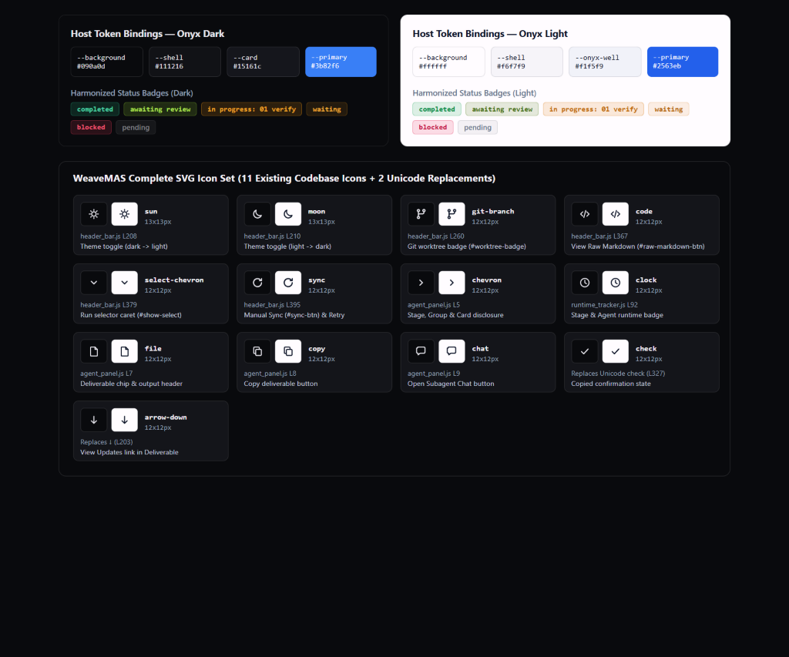

# WeaveMAS Sidecar UI Design System (`DESIGN.md`)

> **Scope:** Persistent styling and theme-inheritance specification for `sidecars/panel/` (and shared VS Code webview `extensions/vscode-viewer/`).
> **Core Rule — Styling Only, Zero Functional Redesign:** Preserve 100% of WeaveMAS's existing layout, component hierarchy, DOM hooks, and interactions. Bind surfaces, borders, typography, and accents directly to Antigravity (`agy`) host CSS variables, restrain neon glow/blink effects, harmonize status colors across light and dark themes, and standardize all 13 UI icons on crisp inline SVGs.
> **Interactive HTML Specimen:** [docs/ui-mocks/design.html](docs/ui-mocks/design.html)

---

## Visual Token & Complete SVG Icon Specimen

### Browser-Verified Render (`docs/ui-mocks/design.html`)

### Standalone Vector Icon Sheet (`docs/ui-mocks/design-icons.svg`)

---

## 1. Native `agy` Host Theme Inheritance & Live `theme-change` Sync

1. **Host Seed & Contrast Resolution (`antigravity-sidecar-kit` pattern):**
   - Resolve active Antigravity theme mode, contrast (`normal` / `high`), font scale (`jetski.fontSize`), and custom/preset color seeds from `~/.gemini/config/config.json` and Antigravity `app_storage.json` on the server (`GET /api/theme` + initial inline CSS variables on `index.html`), while also respecting any CSS custom properties injected directly by `/preload.js` (`SidecarApp`) or VS Code webviews.
2. **Direct CSS Variable Binding (with safe fallbacks only when undefined):**
   - Remove the hardcoded hex overrides inside `[data-theme="dark"]` (`#131316`) and `[data-theme="light"]` (`#f8fafc`) and remove the ~120 lines of `[data-theme="light"] .text-slate-* !important` patches in `styles.css`.
   - Bind WeaveMAS tokens directly to host CSS variables:
     - `--agy-bg: var(--background, var(--vscode-editor-background, #090a0d))`
     - `--agy-fg: var(--foreground, var(--vscode-editor-foreground, #e5e7eb))`
     - `--agy-fg-secondary: var(--secondary-foreground, color-mix(in srgb, var(--agy-fg) 78%, var(--agy-bg)))`
     - `--agy-fg-muted: var(--muted-foreground, color-mix(in srgb, var(--agy-fg) 56%, var(--agy-bg)))`
     - `--agy-fg-subtle: var(--placeholder, color-mix(in srgb, var(--agy-fg) 38%, var(--agy-bg)))`
     - `--agy-card: var(--card, #14151a)`
     - `--agy-surface: var(--shell, color-mix(in srgb, var(--agy-fg) 3%, var(--agy-bg)))`
     - `--agy-well: var(--onyx-well, color-mix(in srgb, var(--agy-fg) 4%, var(--agy-bg)))`
     - `--agy-line: var(--border, color-mix(in srgb, var(--agy-fg) 9%, transparent))`
     - `--agy-card-line: var(--card-border, var(--agy-line))`
     - `--agy-field: var(--secondary, color-mix(in srgb, var(--agy-fg) 6%, transparent))`
     - `--agy-accent: var(--primary, #3b82f6)`
     - `--agy-ring: color-mix(in srgb, var(--agy-accent) 65%, transparent)`
3. **Dynamic `theme-change` Message Listener (No Reload Required):**
   - Register `window.addEventListener("message", ...)` listening for `theme-change` events (`event.data?.type === 'theme-change'`) to update `document.documentElement.dataset.theme`, `document.documentElement.style.colorScheme`, optional host `cssVariables`, and the `#theme-toggle-btn` icon/ARIA attributes immediately without page reload.

---

## 2. Restrained Semantic Status Styling

All 6 status states share a consistent translucent badge treatment (`color-mix()` fill + `1px` border + readable semantic text) that harmonizes automatically on both dark and light host themes—replacing `.vivid-pulse`'s solid `#f59e0b` full-badge flashing and `.stage-dot-*`'s heavy `10px–14px` neon `box-shadow` halos:

| Semantic State | Base Token | Dark Fallback | Light Fallback | Badge Fill / Border / Text Formula |
|---|---|---|---|---|
| **Completed / Approved** | `--agy-ok` | `var(--success, #34d399)` | `var(--success, #16a34a)` | Fill `14%`, Border `32%`, Text `color-mix(in srgb, var(--agy-ok) 85%, var(--agy-fg))` |
| **Awaiting Review** | `--agy-rev` | `#a3e635` | `#4d7c0f` | Fill `15%`, Border `34%`, Text `color-mix(in srgb, var(--agy-rev) 85%, var(--agy-fg))` |
| **In Progress / Active** | `--agy-warn` | `var(--warning, #f59e0b)` | `var(--warning, #d97706)` | Fill `15%`, Border `38%` (subtle border-opacity pulse, no solid orange flash), Text `88%` |
| **Waiting / Worktree** | `--agy-warn` | `var(--warning, #f59e0b)` | `var(--warning, #d97706)` | Fill `11%`, Border `26%`, Text `color-mix(in srgb, var(--agy-warn) 82%, var(--agy-fg))` |
| **Blocked / Error / Missing** | `--agy-err` | `var(--error, #f43f5e)` | `var(--error, #e11d48)` | Fill `14%`, Border `34%`, Text `color-mix(in srgb, var(--agy-err) 86%, var(--agy-fg))` |
| **Pending / Neutral** | `--agy-fg-muted` | `#94a3b8` | `#64748b` | Fill `var(--agy-field)`, Border `var(--agy-card-line)`, Text `var(--agy-fg-muted)` |

- **Motion Restraint:** Active stepper dot (`.stage-dot-flashing`) uses a subtle `3px` ring pulse instead of a `14px` neon glow; `@media (prefers-reduced-motion: reduce)` disables all pulses and transitions.

---

## 3. Typography, Spacing, Radii & Layering

- **Font Stacks:**
  - `--agy-font`: `var(--vscode-font-family, var(--font-family, system-ui, -apple-system, BlinkMacSystemFont, "Segoe UI", Roboto, sans-serif))`
  - `--agy-mono`: `var(--editor-font-family, ui-monospace, SFMono-Regular, Menlo, Monaco, Consolas, monospace)`
- **4 Tight Size Levels (scaled with `--app-font-scale, 1`):**
  - `10px` (`--text-2xs`): Status badges, stepper stage-name subtitle, worktree tag (`10.5px`)
  - `11px` (`--text-xs`): Stepper `Stage N` label, deliverable chips, runtime badges, `#show-select` (`11.5px`), toolbar metadata
  - `12px` (`--text-sm`): Agent card titles, group titles, stage section titles, code/log body
  - `14px` (`--text-base`): `StagePanel` heading
- **Spacing & Layering:** Existing `4px`/`8px`/`12px`/`16px` rhythm preserved; `z-index`: `0` (`#stepper-line`), `10` (`.stage-dot`), `20` (`.agy-header`).

---

## 4. Complete WeaveMAS SVG Icon Catalog (Zero Unicode Icons)

WeaveMAS uses **13 inline `16x16` SVG icons** (`aria-hidden="true"`): the **11 existing codebase SVGs** plus **2 `12x12` stroke SVGs** (`check` and `arrow-down`) replacing the remaining raw Unicode characters in `agent_panel.js` (`L176`, `L203`, `L327`). Separator bullets (`&bull;` and `U+2022`) are replaced by CSS `border-radius: 50%` dots (`.weave-sep-dot`, `.weave-log-bullet`).

| # | Icon ID | Rendered Size | Component / File Location | Exact `viewBox="0 0 16 16"` SVG Markup |
|---|---|---|---|---|
| 1 | `sun` | `13x13px` | `#theme-toggle-btn` when dark (`header_bar.js` `L208`) | `<svg class="agy-theme-icon" data-theme-icon="sun" viewBox="0 0 16 16" fill="none" aria-hidden="true"><circle cx="8" cy="8" r="3" stroke="currentColor" stroke-width="1.4"/><path d="M8 1.75v1.5M8 12.75v1.5M1.75 8h1.5M12.75 8h1.5M3.58 3.58l1.06 1.06M11.36 11.36l1.06 1.06M12.42 3.58l-1.06 1.06M4.64 11.36l-1.06 1.06" stroke="currentColor" stroke-width="1.4" stroke-linecap="round"/></svg>` |
| 2 | `moon` | `13x13px` | `#theme-toggle-btn` when light (`header_bar.js` `L210`) | `<svg class="agy-theme-icon" data-theme-icon="moon" viewBox="0 0 16 16" fill="none" aria-hidden="true"><path d="M13.25 9.85A5.5 5.5 0 0 1 6.15 2.75a5.5 5.5 0 1 0 7.1 7.1Z" stroke="currentColor" stroke-width="1.4" stroke-linecap="round" stroke-linejoin="round"/></svg>` |
| 3 | `git-branch` | `12x12px` | `#worktree-badge` (`header_bar.js` `L260`) | `<svg class="weave-icon" width="12" height="12" viewBox="0 0 16 16" fill="currentColor" aria-hidden="true"><path d="M9.5 3.25a2.25 2.25 0 1 1 3 2.122V6A2.5 2.5 0 0 1 10 8.5H6a1 1 0 0 0-1 1v1.128a2.251 2.251 0 1 1-1.5 0V5.372a2.25 2.25 0 1 1 1.5 0v1.836A2.493 2.493 0 0 1 6 7h4a1 1 0 0 0 1-1v-.628A2.25 2.25 0 0 1 9.5 3.25Zm-6 0a.75.75 0 1 0 1.5 0 .75.75 0 0 0-1.5 0Zm8.25-.75a.75.75 0 1 0 0 1.5.75.75 0 0 0 0-1.5ZM4.25 12a.75.75 0 1 0 0 1.5.75.75 0 0 0 0-1.5Z"/></svg>` |
| 4 | `code` | `12x12px` | `#raw-markdown-btn` (`header_bar.js` `L367`) | `<svg class="agy-sync-icon" viewBox="0 0 16 16" fill="none" aria-hidden="true"><path d="M5.25 5L2.25 8l3 3M10.75 5l3 3-3 3M9.25 3.25l-2.5 9.5" stroke="currentColor" stroke-width="1.4" stroke-linecap="round" stroke-linejoin="round"/></svg>` |
| 5 | `select-chevron` | `12x12px` | `#show-select` caret (`header_bar.js` `L379`) | `<svg class="agy-select-chevron" viewBox="0 0 16 16" fill="none" aria-hidden="true"><path d="M4.5 6.25L8 9.75l3.5-3.5" stroke="currentColor" stroke-width="1.5" stroke-linecap="round" stroke-linejoin="round"/></svg>` |
| 6 | `sync` | `12x12px` | `#sync-btn` (`header_bar.js` `L395`) | `<svg class="agy-sync-icon" viewBox="0 0 16 16" fill="none" aria-hidden="true"><path d="M13.5 8a5.5 5.5 0 1 1-1.38-3.65M13.5 2.5v2.75h-2.75" stroke="currentColor" stroke-width="1.5" stroke-linecap="round" stroke-linejoin="round"/></svg>` |
| 7 | `chevron` | `12x12px` | Stage, Group, and Card expand chevron (`agent_panel.js` `L5`) | `<svg class="weave-icon weave-chevron" data-weave-icon="chevron" width="12" height="12" viewBox="0 0 16 16" fill="none" aria-hidden="true"><path d="M6.25 4.5L9.75 8l-3.5 3.5" stroke="currentColor" stroke-width="1.5" stroke-linecap="round" stroke-linejoin="round"/></svg>` |
| 8 | `clock` | `12x12px` | Stage & Agent runtime badge (`runtime_tracker.js` `L92`) | `<svg class="weave-icon weave-clock-icon" data-weave-icon="clock" width="12" height="12" viewBox="0 0 16 16" fill="none" aria-hidden="true"><circle cx="8" cy="8" r="5.75" stroke="currentColor" stroke-width="1.4"/><path d="M8 4.75V8l2.25 1.5" stroke="currentColor" stroke-width="1.4" stroke-linecap="round" stroke-linejoin="round"/></svg>` |
| 9 | `file` | `12x12px` | Deliverable chip, toolbar & multi-output header (`agent_panel.js` `L7`) | `<svg class="weave-icon weave-file-icon" data-weave-icon="file" width="12" height="12" viewBox="0 0 16 16" fill="none" aria-hidden="true"><path d="M4.25 2.25h5.25L12.75 5.5v8.25a.75.75 0 0 1-.75.75H4.25a.75.75 0 0 1-.75-.75V3a.75.75 0 0 1 .75-.75Z" stroke="currentColor" stroke-width="1.4" stroke-linejoin="round"/><path d="M9.5 2.25V5.5h3.25" stroke="currentColor" stroke-width="1.4" stroke-linecap="round" stroke-linejoin="round"/></svg>` |
| 10 | `copy` | `12x12px` | Copy Deliverable button (`agent_panel.js` `L8`) | `<svg class="weave-icon weave-copy-icon" data-weave-icon="copy" width="12" height="12" viewBox="0 0 16 16" fill="none" aria-hidden="true"><rect x="5.5" y="5.5" width="7.75" height="8.25" rx="1.25" stroke="currentColor" stroke-width="1.4"/><path d="M10.5 5.5V3.5a1.25 1.25 0 0 0-1.25-1.25H4A1.25 1.25 0 0 0 2.75 3.5v6.25A1.25 1.25 0 0 0 4 11h1.5" stroke="currentColor" stroke-width="1.4" stroke-linecap="round" stroke-linejoin="round"/></svg>` |
| 11 | `chat` | `12x12px` | `Open Subagent Chat` button (`agent_panel.js` `L9`) | `<svg class="weave-icon weave-chat-icon" data-weave-icon="chat" width="12" height="12" viewBox="0 0 16 16" fill="none" aria-hidden="true"><path d="M2.75 3.75a1.5 1.5 0 0 1 1.5-1.5h7.5a1.5 1.5 0 0 1 1.5 1.5v5.5a1.5 1.5 0 0 1-1.5 1.5H6.5l-2.75 2.25v-2.25h-.5a1.5 1.5 0 0 1-1.5-1.5v-5.5Z" stroke="currentColor" stroke-width="1.4" stroke-linejoin="round"/></svg>` |
| 12 | `check` *(new)* | `12x12px` | `Copied` confirmation state on Copy button (replaces raw Unicode check in `L327`) | `<svg class="weave-icon weave-check-icon" data-weave-icon="check" width="12" height="12" viewBox="0 0 16 16" fill="none" aria-hidden="true"><path d="M3.5 8.5l3 3 6-6.5" stroke="currentColor" stroke-width="1.5" stroke-linecap="round" stroke-linejoin="round"/></svg>` |
| 13 | `arrow-down` *(new)* | `12x12px` | `View Updates` toggle button in Deliverable drawer (replaces `&darr;` in `L203`) | `<svg class="weave-icon weave-arrow-icon" data-weave-icon="arrow-down" width="12" height="12" viewBox="0 0 16 16" fill="none" aria-hidden="true"><path d="M8 3.25v9.5M4.5 9.25L8 12.75l3.5-3.5" stroke="currentColor" stroke-width="1.4" stroke-linecap="round" stroke-linejoin="round"/></svg>` |
