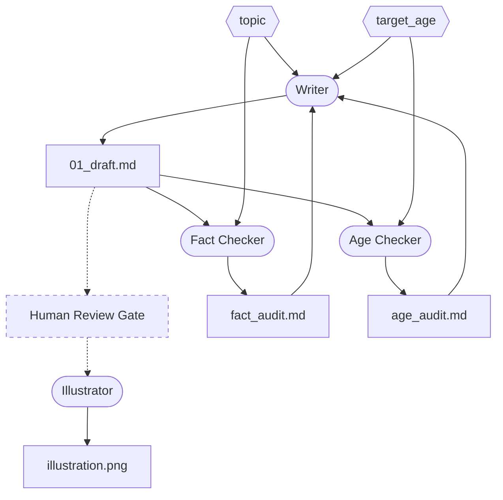

# WeaveMAS

**WeaveMAS** is a declarative orchestration framework and Model Context Protocol (MCP) runtime for rapid prototyping of structured multi-agent pipelines in **Google Antigravity (`agy`)** and other MCP-capable agent harnesses.

## Quick Example: KidsWiki

With the `weavemas` plugin enabled in Antigravity, a single prompt to `weave-authoring` synthesizes a complete 2-stage, 4-agent illustrated encyclopedia pipeline in plain Markdown -- zero orchestration code required:

> Use the `weave-authoring` skill to create a 2-stage KidsWiki pipeline for a `topic` and `target_age` (3-12, default 4). Stage 1 (Editorial): a Writer drafts the article with an `` placeholder and italicized caption; a Fact Checker and Age Checker audit accuracy and readability in parallel with an in-place revision loop; then a human review gate approves `01_draft.md`. Stage 2 (Publishing): an Illustrator generates `illustration.png` from the alt-text prompt.

### Induced Workflow Graph



*Shapes: Hexagon = Parameter, Stadium = Agent, Rectangle = File, Dashed = Control-Plane Gate.*

### Generated Markdown Specifications ([`examples/kidswiki/`](examples/kidswiki/))

| File | Role in Pipeline |
| :--- | :--- |
| [`orchestrator.md`](examples/kidswiki/orchestrator.md) | Root stage roadmap, inputs (`topic`, `target_age`), and review gate. |
| [`orchestrator/stage1_editorial.md`](examples/kidswiki/orchestrator/stage1_editorial.md) | Stage 1 port bindings and parallel verification loop (`writer`, `fact_checker`, `age_checker`). |
| [`orchestrator/stage2_publishing.md`](examples/kidswiki/orchestrator/stage2_publishing.md) | Stage 2 port binding (`draft.md: ${RUN_DIR}/01_draft.md` -> `illustration.png`). |
| [`.agent/agents/stage1_writer.md`](examples/kidswiki/.agent/agents/stage1_writer.md) | Multi-task writer (`01_concepts` -> `02_draft`) authoring prose and alt-text prompt. |
| [`.agent/agents/stage1_fact_checker.md`](examples/kidswiki/.agent/agents/stage1_fact_checker.md) | Scientific accuracy auditor (`search_web`, `fact_audit.md`). |
| [`.agent/agents/stage1_age_checker.md`](examples/kidswiki/.agent/agents/stage1_age_checker.md) | Age-calibrated readability auditor (`age_audit.md`). |
| [`.agent/agents/stage2_illustrator.md`](examples/kidswiki/.agent/agents/stage2_illustrator.md) | Image synthesis agent extracting the approved alt-text prompt (`illustration.png`). |
| [`orchestrator_trigger.md`](examples/kidswiki/orchestrator_trigger.md) | Workspace trigger rule (placed in `.agent/rules/orchestrator_trigger.md`). |

### Run and Inspect

1. **Activate trigger**: Move `orchestrator_trigger.md` into `.agent/rules/orchestrator_trigger.md`.
2. **Execute**: Prompt `"Write a KidsWiki article about 'Rocket' for a 4yo."`
3. **Observe & Steer**: Click `[WeaveMAS UI](sidecar://weavemas/panel/)` in chat to monitor the 2-stage stepper, live agent cards, port badges, and deliverables in `runs/kidswiki_rocket_age4/`. Approve `01_draft.md` at the Stage 1 gate to unlock illustration, or request targeted natural-language edits (routed via `send_message` to the persisted worker `conversation_id`).

## Why WeaveMAS?

Prompting a single LLM in one pass works well for short, self-contained tasks, but breaks down on complex, multi-part digital assets as competing constraints dilute context, subtle factual errors slip past self-critique, and monolithic tool/model assignments waste compute. Existing multi-agent approaches pull in two directions:

- **Code-centric state graphs** (e.g., LangGraph, AutoGen, MetaGPT) provide static typing and state checkpointing, but require writing Python or TypeScript glue code, maintaining package environments, and pre-coding skip guards before interactive revisions can avoid full downstream replay.
- **Open-ended agent harnesses and iterative single-agent ("Ralph") loops** avoid orchestration code, yet drift across folder layouts from run to run, lose constraints across conversational summaries, share correlated blind spots when one persona grades its own work, wander across unrestricted workspace directories, and expose poor visibility into intermediate progress.

WeaveMAS brings repeatable pipeline structure to agent harnesses without orchestration code:

- **Declarative Markdown Specifications**: Agents and stage guides are plain Markdown -- hand-authored or synthesized from a short brief via `weave-authoring`.
- **Sandboxed File & Parameter Port Contracts**: Each worker runs inside an isolated Current Working Directory (`runs/<context_slug>/...`) with explicit input/output port bindings whose cyclic specifications unwind at runtime into acyclic file provenance on disk.
- **Two-Tier Checking**: Pairs authoring-time data-flow auditing (port isomorphism, causal input availability across waves, and output promotion) with zero-LLM runtime contract enforcement via `weavemas_weave`.
- **Interactive Gates & Surgical Asset Edits**: Human review gates pause execution at verified milestone files, while persisted worker sessions (`conversation_id`) enable natural-language cross-stage surgical edits without re-spawning agents.
- **Zero-Token Out-of-Band UI Sidecar**: A local Node.js web panel (`sidecars/panel/`) polls `weave.md` manifests directly from disk with zero LLM calls.

## Installation and Setup

### Prerequisites

- **Node.js >= 20** (pure standard library; zero external `npm` dependencies)
- **Google Antigravity (`agy`)** (or another MCP-capable CLI/IDE harness)

### Option 1: Install as an Antigravity Plugin (Recommended)

Clone this repository into your Antigravity plugins directory:

```bash
# macOS / Linux
git clone https://github.com/axiomfab/weavemas-agy.git ~/.gemini/config/plugins/weavemas

# Windows (PowerShell)
git clone https://github.com/axiomfab/weavemas-agy.git "$HOME/.gemini/config/plugins/weavemas"
```

When enabled in Antigravity (`customization://weavemas`), the plugin automatically registers the `weavemas_weave` MCP server (`mcp_config.json`), core skills (`weave-authoring`, `weave-core-orchestrator`, `weave-core-agent`), control-plane subagents (`provisioner`, `stage_orchestrator`), and the `WeaveMAS UI` sidecar (`sidecars/panel/`).

### Option 2: Standalone `weavemas_weave` MCP Server

To register the MCP state and contract server directly in an MCP host configuration (`mcp_config.json`):

```json
{
  "mcpServers": {
    "weavemas_weave": {
      "command": "node",
      "args": ["/absolute/path/to/weavemas-agy/src/mcp_server.mjs"]
    }
  }
}
```

### MCP Tools (`weavemas_weave`)

All directory arguments (`dir`, `dirs`, `stage_dir`, `directory`, `mirror_to`) must be absolute paths.

| Tool | Role | Summary |
| :--- | :--- | :--- |
| `weave_init` | Orchestrator / Provisioner | Creates `weave.md` (`type`: `"agent"` or `"orchestrator"`, `status`, `instructions_file`, `inputs`, `outputs`, `conversation_id`). |
| `weave_verify` | Worker (Turn 1 & wakeup) | Verifies workspace identity and resolves declared `inputs` into `resolved_inputs` vs. `pending_inputs`. |
| `weave_update` | Orchestrator / Worker | Updates `status`, appends a timestamped log note, records `conversation_id`, and verifies/promotes `outputs` on `completed`. |
| `weave_read` | Orchestrator | Verifies single (`dir`) or batch (`dirs`, `stage_dir`) worker status, `outputs` on disk, and `conversation_id`. |
| `discover_agents` | Orchestrator (Phase 2) | Scans a stage or run directory for provisioned worker `weave.md` manifests matching `filter_status` (default `"initialized"`). |

## The `weave.md` Manifest Contract

Every run root (`runs/<context_slug>/weave.md`) and worker sandbox (`runs/<context_slug>/.../agents/<agent_id>/weave.md`) stores state in an on-disk `weave.md` file managed exclusively via `weavemas_weave`. It pairs a closed 7-key YAML frontmatter header with an append-only Markdown log:

```yaml
---
type: "agent"
status: "in_progress/02_draft"
instructions_file: ".agent/agents/stage1_writer.md"
inputs:
  - "notes.md: ${PROJECT_DIR}/prompts/style_guide.md"
outputs:
  - "draft.md: ${RUN_DIR}/01_draft.md"
conversation_id: "3f8a9c12-4b7e-4d1a-9e2b-8c7d6e5f4a3b"
updated_at: "2026-11-18T10:12:00.000Z"
---

# stage1_writer Status

- 2026-11-18T10:10:00.000Z: `initialized` - Workspace provisioned
- 2026-11-18T10:12:00.000Z: `in_progress/02_draft` - Drafting article prose and alt-text illustration prompt
```

### Frontmatter Keys

- **`type`**: `"agent"` or `"orchestrator"`. Updating an orchestrator manifest requires passing `type: "orchestrator"` to `weave_update`, preventing workers from overwriting the run root.
- **`status`**: Follows `[<stage_slug>/]<state>[/<detail>]` where `<state>` is one of `initialized`, `not_started`, `in_progress`, `waiting`, `awaiting_review`, `blocked`, or `completed`. Workers omit `<stage_slug>` (e.g., `in_progress/02_draft`); staged orchestrators prefix an existing `stageNN_<slug>` folder (e.g., `stage01_editorial/awaiting_review`).
- **`instructions_file`**: Workspace-relative path to the worker's `.agent/agents/<name>.md` file (omitted on orchestrators).
- **`inputs`**: Explicit input file bindings resolved relative to the worker's CWD after expanding `${PROJECT_DIR}` (repo root), `${RUN_DIR}` (`runs/<context_slug>`), and `${AGENT_DIR}` (worker CWD). Supports sibling paths (`../writer/draft.md`), `*` globs, and aliases (`draft.md: ${RUN_DIR}/01_draft.md`) so agent prompts refer only to local filenames. Unprefixed bare filenames resolve strictly inside the worker's CWD with no implicit fallback.
- **`outputs`**: Expected local output file(s)/glob(s) or promoted bindings (`<local_file>: <target_path>`). When transitioning to `completed`, `weave_update` verifies each output exists on disk and auto-copies mapped files to `<target_path>`.
- **`conversation_id`**: Optional persisted subagent session UUID used by orchestrators to resume workers via `send_message` across revision loops, context compaction, and post-run surgical edits.
- **`updated_at`**: ISO 8601 UTC timestamp updated automatically on each transition.

## Stageless Mode (Single-File `orchestrator.md`)

For compact workflows that do not need intermediate review gates or `orchestrator/stage*.md` files, declare `## Agents` and `## Execution` directly inside a single `orchestrator.md` (with worker sandboxes placed flat under `${RUN_DIR}/agents/<agent_id>/`):

```markdown
# KidsWiki Stageless Orchestrator

Operate as a WeaveMAS orchestrator. You MUST use the `weave-core-orchestrator` skill to manage workspace scaffolding, Phase 1 `provisioner` delegation, and pipeline lifecycle tracking.

## Inputs
- `topic`: Article subject (required).
- `target_age`: Reader age from 3 to 12 (default: 4).

## Run Directory Structure
Every run is scoped to `runs/kidswiki_<topic_slug>_age<target_age>/`.

## Agents

### Writer: `writer`
* **Instructions**: [stage1_writer.md](.agent/agents/stage1_writer.md)
* **Working Directory**: `${RUN_DIR}/agents/writer/`
* **Outputs**:
  - `draft.md: ${RUN_DIR}/article.md`

### Fact Checker: `fact_checker`
* **Instructions**: [stage1_fact_checker.md](.agent/agents/stage1_fact_checker.md)
* **Working Directory**: `${RUN_DIR}/agents/fact_checker/`
* **Inputs**:
  - `../writer/draft.md`
* **Outputs**:
  - `fact_audit.md`

## Execution
1. **`writer`**:
   - Parameters: `topic`, `target_age`
   - Execution: Draft the article to `draft.md` (promoted automatically to `${RUN_DIR}/article.md`).
2. **`fact_checker`**:
   - Parameters: `topic`
   - Execution: Audit `../writer/draft.md` and write `fact_audit.md`. If `verdict: FAIL` (max 2 cycles), send corrections to `writer` via `send_message` and re-verify.
```

## Testing

Run the Node.js test suite:

```bash
npm test
```

## License

Released under the [MIT License](LICENSE).
