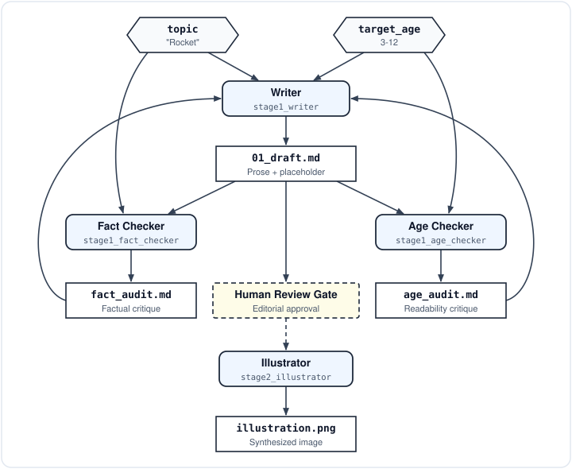
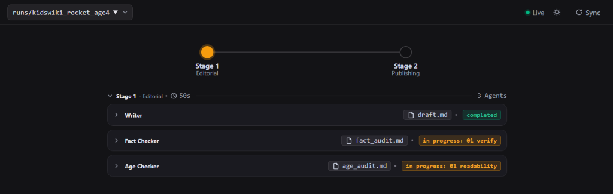

# WeaveMAS

**WeaveMAS** is a declarative orchestration layer for Google Antigravity (`agy`) that lets you define, rapidly prototype, and run structured multi-agent systems in plain Markdown, with zero code. You specify orchestrators and specialist agents in partially predefined Markdown files; WeaveMAS orchestrator and agent skills (`weave-core-orchestrator`, `weave-core-agent`) ensure those definitions execute through predictable protocols; and programmatic Weave MCP tools (`weavemas_weave`) enforce port contracts and manage execution lifecycles on disk in `weave.md` files. While currently built and tested for Antigravity, its design can be readily adapted to other agent harnesses such as Claude Code and Codex as future work (available upon request).

## Quick Example: KidsWiki

With the `weavemas` plugin enabled in Antigravity, a single prompt to `weave-authoring` synthesizes a complete 2-stage, 4-agent illustrated encyclopedia pipeline in plain Markdown -- zero orchestration code required:

> Use the `weave-authoring` skill to create a 2-stage KidsWiki pipeline for a `topic` and `target_age` (3-12, default 4). Stage 1 (Editorial): a Writer drafts the article with an `` placeholder and italicized caption; a Fact Checker and Age Checker audit accuracy and readability in parallel with an in-place revision loop; then a human review gate approves `01_draft.md`. Stage 2 (Publishing): an Illustrator generates `illustration.png` from the alt-text prompt.

### Induced Workflow Graph



### Generated Markdown Specifications ([`examples/kidswiki/`](examples/kidswiki/))

<details>
<summary><strong>Orchestrator</strong> -- Root stage roadmap, inputs (<code>topic</code>, <code>target_age</code>), and review gate.</summary>

File: [`orchestrator.md`](examples/kidswiki/orchestrator.md)

```markdown
# Multi-Agent KidsWiki Orchestrator Guide

Operate as a WeaveMAS orchestrator. You MUST use the `weave-core-orchestrator` skill to manage stage scaffolding, per-stage `stage_orchestrator` delegation, and pipeline lifecycle tracking.

## Inputs
- `topic`: Article subject (e.g., `"Rocket"`). Required.
- `target_age`: Target reader age between `3` and `12` (default: `4`).

## Run Directory Structure
Every run is scoped to `runs/kidswiki_<topic_slug>_age<target_age>/`.

## Execution

### Stage 1: Editorial & Verification
* **Execution Directory**: `stage01_editorial/`
* **Protocol**: [orchestrator/stage1_editorial.md](orchestrator/stage1_editorial.md)
* **Parameters**: `topic`, `target_age`
* **Output**: `01_draft.md`
* **Gate**: Explicit user review approval required before unlocking Stage 2.

### Stage 2: Illustration & Publishing
* **Execution Directory**: `stage02_publishing/`
* **Protocol**: [orchestrator/stage2_publishing.md](orchestrator/stage2_publishing.md)
* **Parameters**: `none`
* **Output**: `illustration.png`
```

</details>

<details>
<summary><strong>Stage 1: Editorial</strong> -- Drafts the article, runs parallel fact and age audits with a revision loop, and pauses at the review gate.</summary>

File: [`orchestrator/stage1_editorial.md`](examples/kidswiki/orchestrator/stage1_editorial.md)
Port bindings: `writer` promotes `draft.md` to `${RUN_DIR}/01_draft.md`; `fact_checker` and `age_checker` read `../writer/draft.md` and emit `fact_audit.md` / `age_audit.md`.

```markdown
# Stage 1: Editorial & Verification

## Objective
Draft an age-calibrated KidsWiki article with an embedded illustration placeholder, then verify scientific accuracy and readability in parallel before human approval.

## Agents

### Writer Agent: `writer`
* **Instructions**: [stage1_writer.md](.agent/agents/stage1_writer.md)
* **Working Directory**: `${RUN_DIR}/stage01_editorial/agents/writer/`
* **Outputs**:
  - `draft.md: ${RUN_DIR}/01_draft.md`

### Fact Checker Agent: `fact_checker`
* **Instructions**: [stage1_fact_checker.md](.agent/agents/stage1_fact_checker.md)
* **Working Directory**: `${RUN_DIR}/stage01_editorial/agents/fact_checker/`
* **Inputs**:
  - `../writer/draft.md`
* **Outputs**:
  - `fact_audit.md`

### Age Checker Agent: `age_checker`
* **Instructions**: [stage1_age_checker.md](.agent/agents/stage1_age_checker.md)
* **Working Directory**: `${RUN_DIR}/stage01_editorial/agents/age_checker/`
* **Inputs**:
  - `../writer/draft.md`
* **Outputs**:
  - `age_audit.md`

## Execution
1. **`writer`**:
   - Parameters: `topic`, `target_age`
   - Execution: Draft the article and in-place `` placeholder to `draft.md` (promoted automatically to `${RUN_DIR}/01_draft.md`).
2. **`fact_checker` & `age_checker` (execute in parallel)**:
   - `fact_checker` Parameters: `topic`
   - `age_checker` Parameters: `target_age`
   - Execution: Audit `../writer/draft.md` concurrently for factual accuracy (`fact_audit.md`) and age readability (`age_audit.md`). If either audit returns `verdict: FAIL` (max 2 revision cycles), route combined critique feedback to `writer` via `send_message` and re-run the failed checker(s).
3. **User Review Gate**:
   - Present `01_draft.md` for approval via WeaveMAS UI and a direct `${RUN_DIR}/01_draft.md` link (zero-copy); route any revision feedback to `writer` via `send_message`.
```

</details>

<details>
<summary><strong>Stage 2: Publishing</strong> -- Generates <code>illustration.png</code> from the approved draft's alt-text prompt.</summary>

File: [`orchestrator/stage2_publishing.md`](examples/kidswiki/orchestrator/stage2_publishing.md)
Port bindings: `illustrator` maps `${RUN_DIR}/01_draft.md` to local `draft.md` and promotes `illustration.png` to `${RUN_DIR}/illustration.png`.

```markdown
# Stage 2: Illustration & Publishing

## Objective
Extract the approved alt-text visual prompt from `01_draft.md` and generate `illustration.png` to complete the illustrated article in place.

## Agents

### Illustrator Agent: `illustrator`
* **Instructions**: [stage2_illustrator.md](.agent/agents/stage2_illustrator.md)
* **Working Directory**: `${RUN_DIR}/stage02_publishing/agents/illustrator/`
* **Inputs**:
  - `draft.md: ${RUN_DIR}/01_draft.md`
* **Outputs**:
  - `illustration.png: ${RUN_DIR}/illustration.png`

## Execution
1. **`illustrator`**:
   - Parameters: `none`
   - Execution: Read `draft.md`, extract the visual prompt from ``, and generate `illustration.png` (promoted automatically to `${RUN_DIR}/illustration.png`).
```

</details>

<details>
<summary><strong>Writer</strong> -- Multi-task writer (<code>01_concepts</code> -> <code>02_draft</code>) authoring prose and alt-text prompt.</summary>

File: [`.agent/agents/stage1_writer.md`](examples/kidswiki/.agent/agents/stage1_writer.md)

````markdown
---
name: stage1_writer
description: Writes age-calibrated educational wiki articles for children aged 3 to 12
model: flash
subagent: true
inheritCustomizations: true
inheritMcp: true
skills:
  - weave-core-agent
tools:
  - view_file
  - write_to_file
---

# KidsWiki Writer Agent

You write concise, scientifically accurate encyclopedia articles calibrated to `target_age` for the assigned `topic`.

Operate as a WeaveMAS agent. You MUST use the `weave-core-agent` skill to manage your status and lifecycle at every step.

# Role Specifics
* **Output Target**: Save your completed article to `draft.md`.

# Tasks

## Task: 01_concepts
Select 3 core factual concepts for `topic` and calibrate length and vocabulary to `target_age` (3-5: 60-100 words, simple sensory words; 6-8: 120-180 words, clear cause-and-effect; 9-12: 200-300 words, technical terms explained in context).

## Task: 02_draft
Write `draft.md` containing:
1. `# <Title>`
2. An in-place Markdown image tag whose alt-text holds a self-contained 2-3 sentence visual prompt, followed immediately by an italicized caption:
   ```markdown
   
   *<Short caption>*
   ```
3. The age-calibrated article prose.

On revision messages, update `draft.md` in place to resolve every flagged item.

# Lifecycle
1. `01_concepts`
2. `02_draft`
````

</details>

<details>
<summary><strong>Fact Checker</strong> -- Scientific accuracy auditor (<code>search_web</code>, <code>fact_audit.md</code>).</summary>

File: [`.agent/agents/stage1_fact_checker.md`](examples/kidswiki/.agent/agents/stage1_fact_checker.md)

```markdown
---
name: stage1_fact_checker
description: Audits KidsWiki drafts strictly for factual and scientific accuracy
model: flash
subagent: true
inheritCustomizations: true
inheritMcp: true
skills:
  - weave-core-agent
tools:
  - view_file
  - search_web
  - write_to_file
---

# KidsWiki Fact Checker Agent

You audit `draft.md` strictly for scientific and factual accuracy on `topic`, catching oversimplified myths or false claims.

Operate as a WeaveMAS agent. You MUST use the `weave-core-agent` skill to manage your status and lifecycle at every step.

# Role Specifics
* **Output Target**: Write your factual audit report starting with `verdict: PASS` or `verdict: FAIL` to `fact_audit.md`.
```

</details>

<details>
<summary><strong>Age Checker</strong> -- Age-calibrated readability auditor (<code>age_audit.md</code>).</summary>

File: [`.agent/agents/stage1_age_checker.md`](examples/kidswiki/.agent/agents/stage1_age_checker.md)

```markdown
---
name: stage1_age_checker
description: Audits KidsWiki drafts and captions for age-appropriate readability
model: flash
subagent: true
inheritCustomizations: true
inheritMcp: true
skills:
  - weave-core-agent
tools:
  - view_file
  - write_to_file
---

# KidsWiki Age Checker Agent

You audit `draft.md` (including both prose and the italicized image caption) for vocabulary, sentence length, and tone suited to `target_age`.

Operate as a WeaveMAS agent. You MUST use the `weave-core-agent` skill to manage your status and lifecycle at every step.

# Role Specifics
* **Output Target**: Write your readability audit report starting with `verdict: PASS` or `verdict: FAIL` to `age_audit.md`.
```

</details>

<details>
<summary><strong>Illustrator</strong> -- Image synthesis agent extracting the approved alt-text prompt (<code>illustration.png</code>).</summary>

File: [`.agent/agents/stage2_illustrator.md`](examples/kidswiki/.agent/agents/stage2_illustrator.md)

```markdown
---
name: stage2_illustrator
description: Generates the article illustration from the approved Markdown alt-text prompt
model: flash
subagent: true
inheritCustomizations: true
inheritMcp: true
skills:
  - weave-core-agent
tools:
  - view_file
  - invoke_subagent
---

# KidsWiki Illustrator Agent

You read `draft.md`, extract the visual prompt from ``, and generate `illustration.png` in your working directory via the `image-generator` subagent.

Operate as a WeaveMAS agent. You MUST use the `weave-core-agent` skill to manage your status and lifecycle at every step.

# Role Specifics
* **Output Target**: Save the generated image to `illustration.png`.
```

</details>

<details>
<summary><strong>Orchestrator Trigger</strong> -- Workspace trigger rule (placed in <code>.agent/rules/orchestrator_trigger.md</code>).</summary>

File: [`orchestrator_trigger.md`](examples/kidswiki/orchestrator_trigger.md)

```markdown
---
trigger: always_on
---

# KidsWiki Pipeline Protocol

## 1. Pipeline Execution
**Trigger:** Any request to write, generate, or run a KidsWiki article (e.g., "Write a KidsWiki article about ...").
**Action:** Before invoking any subagents or running commands, read `orchestrator.md` (do NOT preload `orchestrator/*.md` stage guides into the root orchestrator -- delegate each stage to `stage_orchestrator`).

## 2. Outcome Feedback & Pipeline Revision
**Trigger:** Any request providing feedback, critique, or surgical edits on a completed run in `runs/<context_slug>/`.
**Action:** Activate the `weave-authoring` skill and follow `references/authoring_revision.md` (or route run-specific surgical edits via `send_message` to the persisted `conversation_id`).
```

</details>

### Run and Inspect

1. **Activate trigger**: Move `orchestrator_trigger.md` into `.agent/rules/orchestrator_trigger.md`.
2. **Execute**: Prompt `"Write a KidsWiki article about 'Rocket' for a 4yo."`
3. **Observe & Steer**: Click `[WeaveMAS UI](sidecar://weavemas/panel/)` in chat to monitor the 2-stage stepper, live agent cards, port badges, and deliverables in `runs/kidswiki_rocket_age4/`. Approve `01_draft.md` at the Stage 1 gate to unlock illustration, or request targeted natural-language edits (routed via `send_message` to the persisted worker `conversation_id`).



## Why WeaveMAS?

Prompting a single LLM in one pass works well for short, self-contained tasks, but breaks down on complex, multi-part digital assets as competing constraints dilute context, subtle factual errors slip past self-critique, and monolithic tool/model assignments waste compute. Existing multi-agent approaches pull in two directions:

- **Code-centric state graphs** (e.g., LangGraph, AutoGen, MetaGPT) provide static typing and state checkpointing, but require writing Python or TypeScript glue code, maintaining package environments, and pre-coding skip guards before interactive revisions can avoid full downstream replay.
- **Open-ended agent harnesses and iterative single-agent ("Ralph") loops** avoid orchestration code, yet drift across folder layouts from run to run, lose constraints across conversational summaries, share correlated blind spots when one persona grades its own work, wander across unrestricted workspace directories, and expose poor visibility into intermediate progress.

WeaveMAS brings repeatable multi-agent structure to agent harnesses with zero orchestration code through a three-part causal design:

1. **Partially Predefined Markdown Specifications (Zero Code)**: Orchestrators (`orchestrator.md`, `orchestrator/stage*.md`) and specialist worker agents (`.agent/agents/*.md`) are defined in plain Markdown combining structured sections (stages, roles, file/parameter ports, tasks, and review gates) with natural-language instructions, written by hand or synthesized and revised via `weave-authoring`.
2. **Execution Skills for Predictable Protocols**: Dedicated orchestrator and worker skills (`weave-core-orchestrator` and `weave-core-agent`) govern how the harness interprets those Markdown files at runtime, prescribing two-phase workspace provisioning, subagent dispatch, directory discipline, and structured multi-turn handoffs.
3. **MCP Contract Enforcement & `weave.md` Lifecycles**: Programmatic MCP tools (`weavemas_weave`) back those skills on disk, isolating each worker inside its own Current Working Directory (`runs/<context_slug>/...`), validating input/output port bindings, and managing orchestrator and worker lifecycles in structured `weave.md` manifests.

Building on this foundation, WeaveMAS provides:

- **Two-Tier Data-Flow Checking**: Pairs authoring-time auditing (port isomorphism, causal input availability across waves, and output promotion) with zero-LLM runtime contract enforcement via `weavemas_weave`.
- **Interactive Gates & Surgical Asset Edits**: Human review gates pause execution at verified milestone files, while persisted worker sessions (`conversation_id`) enable natural-language cross-stage surgical edits without re-spawning agents or replaying downstream checkpoints.
- **Zero-Token Out-of-Band UI Sidecar**: A local Node.js web panel (`sidecars/panel/`) polls `weave.md` manifests directly from disk with zero LLM calls.

## Installation and Setup

### Prerequisites

- **Node.js >= 20** (pure standard library; zero external `npm` dependencies)
- **Google Antigravity (`agy`)** (or another MCP-capable CLI/IDE harness)

### Option 1: Install as an Antigravity Plugin (Recommended)

Clone this repository into your Antigravity plugins directory:

```bash
# macOS / Linux
git clone https://github.com/axiomfab/weavemas-agy.git ~/.gemini/config/plugins/weavemas

# Windows (PowerShell)
git clone https://github.com/axiomfab/weavemas-agy.git "$HOME/.gemini/config/plugins/weavemas"
```

When enabled in Antigravity (`customization://weavemas`), the plugin automatically registers the `weavemas_weave` MCP server (`mcp_config.json`), core skills (`weave-authoring`, `weave-core-orchestrator`, `weave-core-agent`), control-plane subagents (`provisioner`, `stage_orchestrator`), and the `WeaveMAS UI` sidecar (`sidecars/panel/`).

### Option 2: Standalone `weavemas_weave` MCP Server

To register the MCP state and contract server directly in an MCP host configuration (`mcp_config.json`):

```json
{
  "mcpServers": {
    "weavemas_weave": {
      "command": "node",
      "args": ["/absolute/path/to/weavemas-agy/src/mcp_server.mjs"]
    }
  }
}
```

### MCP Tools (`weavemas_weave`)

All directory arguments (`dir`, `dirs`, `stage_dir`, `directory`, `mirror_to`) must be absolute paths.

| Tool | Role | Summary |
| :--- | :--- | :--- |
| `weave_init` | Orchestrator / Provisioner | Creates `weave.md` (`type`: `"agent"` or `"orchestrator"`, `status`, `instructions_file`, `inputs`, `outputs`, `conversation_id`). |
| `weave_verify` | Worker (Turn 1 & wakeup) | Verifies workspace identity and resolves declared `inputs` into `resolved_inputs` vs. `pending_inputs`. |
| `weave_update` | Orchestrator / Worker | Updates `status`, appends a timestamped log note, records `conversation_id`, and verifies/promotes `outputs` on `completed`. |
| `weave_read` | Orchestrator | Verifies single (`dir`) or batch (`dirs`, `stage_dir`) worker status, `outputs` on disk, and `conversation_id`. |
| `discover_agents` | Orchestrator (Phase 2) | Scans a stage or run directory for provisioned worker `weave.md` manifests matching `filter_status` (default `"initialized"`). |

## The `weave.md` Manifest Contract

Every run root (`runs/<context_slug>/weave.md`) and worker sandbox (`runs/<context_slug>/.../agents/<agent_id>/weave.md`) stores state in an on-disk `weave.md` file managed exclusively via `weavemas_weave`. It pairs a closed 7-key YAML frontmatter header with an append-only Markdown log:

```yaml
---
type: "agent"
status: "in_progress/02_draft"
instructions_file: ".agent/agents/stage1_writer.md"
inputs:
  - "notes.md: ${PROJECT_DIR}/prompts/style_guide.md"
outputs:
  - "draft.md: ${RUN_DIR}/01_draft.md"
conversation_id: "3f8a9c12-4b7e-4d1a-9e2b-8c7d6e5f4a3b"
updated_at: "2026-11-18T10:12:00.000Z"
---

# stage1_writer Status

- 2026-11-18T10:10:00.000Z: `initialized` - Workspace provisioned
- 2026-11-18T10:12:00.000Z: `in_progress/02_draft` - Drafting article prose and alt-text illustration prompt
```

### Frontmatter Keys

- **`type`**: `"agent"` or `"orchestrator"`. Updating an orchestrator manifest requires passing `type: "orchestrator"` to `weave_update`, preventing workers from overwriting the run root.
- **`status`**: Follows `[<stage_slug>/]<state>[/<detail>]` where `<state>` is one of `initialized`, `not_started`, `in_progress`, `waiting`, `awaiting_review`, `blocked`, or `completed`. Workers omit `<stage_slug>` (e.g., `in_progress/02_draft`); staged orchestrators prefix an existing `stageNN_<slug>` folder (e.g., `stage01_editorial/awaiting_review`).
- **`instructions_file`**: Workspace-relative path to the worker's `.agent/agents/<name>.md` file (omitted on orchestrators).
- **`inputs`**: Explicit input file bindings resolved relative to the worker's CWD after expanding `${PROJECT_DIR}` (repo root), `${RUN_DIR}` (`runs/<context_slug>`), and `${AGENT_DIR}` (worker CWD). Supports sibling paths (`../writer/draft.md`), `*` globs, and aliases (`draft.md: ${RUN_DIR}/01_draft.md`) so agent prompts refer only to local filenames. Unprefixed bare filenames resolve strictly inside the worker's CWD with no implicit fallback.
- **`outputs`**: Expected local output file(s)/glob(s) or promoted bindings (`<local_file>: <target_path>`). When transitioning to `completed`, `weave_update` verifies each output exists on disk and auto-copies mapped files to `<target_path>`.
- **`conversation_id`**: Optional persisted subagent session UUID used by orchestrators to resume workers via `send_message` across revision loops, context compaction, and post-run surgical edits.
- **`updated_at`**: ISO 8601 UTC timestamp updated automatically on each transition.

## Stageless Mode (Single-File `orchestrator.md`)

For compact workflows that do not need intermediate review gates or `orchestrator/stage*.md` files, declare `## Agents` and `## Execution` directly inside a single `orchestrator.md` (with worker sandboxes placed flat under `${RUN_DIR}/agents/<agent_id>/`):

```markdown
# KidsWiki Stageless Orchestrator

Operate as a WeaveMAS orchestrator. You MUST use the `weave-core-orchestrator` skill to manage workspace scaffolding, Phase 1 `provisioner` delegation, and pipeline lifecycle tracking.

## Inputs
- `topic`: Article subject (required).
- `target_age`: Reader age from 3 to 12 (default: 4).

## Run Directory Structure
Every run is scoped to `runs/kidswiki_<topic_slug>_age<target_age>/`.

## Agents

### Writer: `writer`
* **Instructions**: [stage1_writer.md](.agent/agents/stage1_writer.md)
* **Working Directory**: `${RUN_DIR}/agents/writer/`
* **Outputs**:
  - `draft.md: ${RUN_DIR}/article.md`

### Fact Checker: `fact_checker`
* **Instructions**: [stage1_fact_checker.md](.agent/agents/stage1_fact_checker.md)
* **Working Directory**: `${RUN_DIR}/agents/fact_checker/`
* **Inputs**:
  - `../writer/draft.md`
* **Outputs**:
  - `fact_audit.md`

## Execution
1. **`writer`**:
   - Parameters: `topic`, `target_age`
   - Execution: Draft the article to `draft.md` (promoted automatically to `${RUN_DIR}/article.md`).
2. **`fact_checker`**:
   - Parameters: `topic`
   - Execution: Audit `../writer/draft.md` and write `fact_audit.md`. If `verdict: FAIL` (max 2 cycles), send corrections to `writer` via `send_message` and re-verify.
```

## Testing

Run the Node.js test suite:

```bash
npm test
```

## License

Released under the [MIT License](LICENSE).
