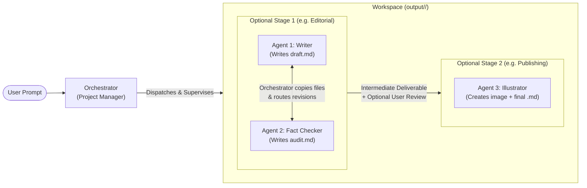
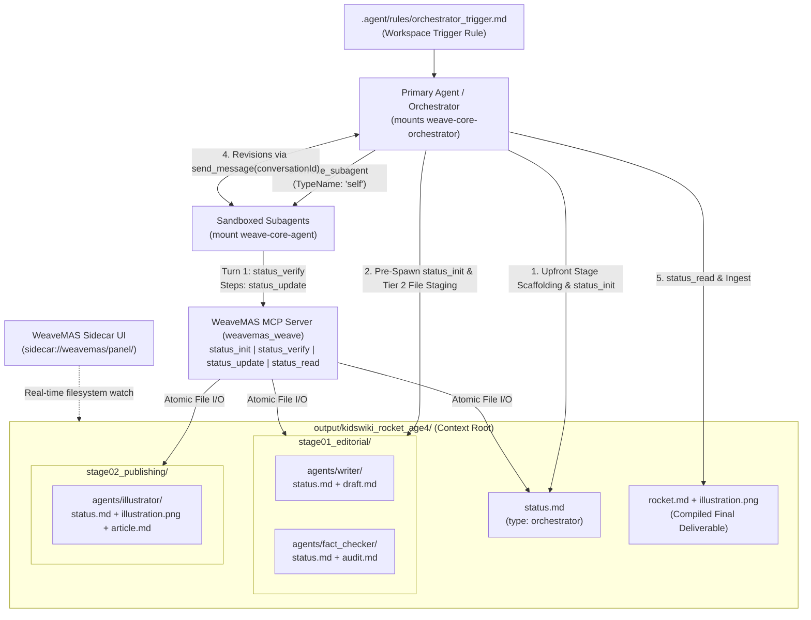

# WeaveMAS: User Guide, Tutorials & Technical Reference

**WeaveMAS** is a plugin for **Google Antigravity (`agy`)** that turns dynamic AI agent dispatch into structured multi-agent pipelines without writing custom coordination or UI code.

This guide is split into two parts:
* **[Part 1: User Guide](#part-1-user-guide)** — Understand Multi-Agent Systems, why WeaveMAS is needed over barebones Antigravity, how **Orchestrators**, **Agents**, and **Stages** interact, and two hands-on tutorials (**without stages** and **with stages**).
* **[Part 2: Technical Guide](#part-2-technical-guide)** — Explore the internal architecture, the 5-key `status.md` state machine, sandboxing rules, and MCP tool specifications.

---

# Part 1: User Guide

## 1. Multi-Agent Systems: Why Go Beyond a Single LLM?

Before diving into WeaveMAS, it is important to understand what a **Multi-Agent System (MAS)** is and why the quality of results produced by a team of specialized agents can be significantly higher than a single large language model (LLM) call, particularly for complex and multi-faceted problems.

When you ask a single LLM to perform a complex creative or analytical job, it must juggle multiple competing objectives in a single prompt: tone, structure, factual accuracy, stylistic formatting, image planning, and self-critique. For trivial questions, a single prompt works well. But as soon as you produce rich, multi-part assets, single-LLM generation runs into hard limits:

* **Context Bloat, Token Degradation & Scale (Tasks Too Big for One LLM)**:
  As conversation history and generated tokens accumulate in a single context window, LLMs suffer from "attention dilution." Models lose track of subtle negative constraints, skip required sections, hallucinate missing details, or hit hard output token caps before completing the job. A multi-agent system solves this by decomposing a large project into independent work units—allowing an orchestrator to dispatch multiple agents in isolation or in parallel (for example, 10 chapter-writer agents working simultaneously, each with a fresh context window).
* **Specialization of Models and Tools**:
  Different tasks require different strengths. A research phase might need real-time web search and an analytical model (`pro`); drafting text benefits from balanced throughput (`flash`); quick extractions or summarizations can be handled cost-effectively by ultra-light models (`flash_lite`); and illustration requires dedicated image generation tools. A multi-agent architecture gives each specialist agent **only the exact tools and model tier** its role requires, avoiding bloated tool descriptions and wasted compute.
* **Quality & Hallucination Elimination (Separation of Concerns)**:
  Even for modest tasks, single prompts often sacrifice factual truth for narrative flow. For instance, in our tutorial's **KidsWiki** project, when a state-of-the-art LLM was prompted in a single shot to write an article explaining "Rockets" to a 4-year-old, its desire to sound whimsical made it generate: *"A rocket is a super-strong space boat that flies all the way to the stars!"* It sounds charming—and it is **scientifically false** (rockets visit orbit, the Moon, or solar system planets; none has ever reached another star). By decoupling the **Writer** (focused 100% on age-appropriate vocabulary) from an independent **Fact Checker** (focused 100% on factual claims), an automated revision loop catches and corrects these slips before publication.
* **Tangible Intermediate Deliverables vs. A "Black Box Brain"**:
  In a single prompt, all intermediate reasoning happens invisibly inside the model's latent space. You cannot inspect preliminary drafts, verify image descriptions, or alter the direction until the entire prompt finishes—and if something is wrong, you must discard and regenerate everything. In a multi-agent system, **every agent writes a real, tangible file to disk** (`draft.md`, `audit.md`, `illustration.png`). You gain full transparency into intermediate milestones as they are created.

### The Trade-Off: Speed vs. Quality & Control

It is important to be upfront about the trade-off: **multi-agent systems are much slower than a single LLM prompt**. 

A single prompt returns in 5 to 10 seconds. A multi-agent pipeline that spawns subagents, writes files to disk, verifies status checklists, runs revision loops, and pauses for review gates will take **minutes instead of seconds**.

**This extra time is the deliberate price you pay for quality, consistency, and control.**

---

## 2. Why WeaveMAS? Structured Pipelines on a Flexible Foundation

### Why Antigravity (`agy`) is Dynamic by Design

General-purpose agent engines like barebones **Google Antigravity (`agy`)** natively support autonomous subagents. However, `agy` is intentionally designed for open-ended, dynamic problem-solving:

* **Maximum Flexibility**: A general-purpose AI platform like `agy` is built to adapt fluidly to non-linear workflows—such as debugging complex codebases, exploring unfamiliar repositories, and conducting open-ended research where each step depends on the previous discovery.
* **Maximum Versatility**: Because `agy` provides an unconstrained, dynamic foundation, it can be guided, structured, and shaped into specialized, deterministic pipelines for specific domains. A flexible, dynamic system can always adopt structure; a rigid, hardcoded system cannot bend to unexpected tasks.

Ultimately, the commercial goal of maximizing flexibility and versatility is to empower a broad, diverse user base across different domains solving a vast variety of problems. This is why **Antigravity 2.0** offers two complementary user surfaces alongside the `agy` CLI: a traditional code-centric **Editor view** for developers, and a project-centric **Agent Manager view** that does not treat code as a primary citizen, focusing instead on abstract projects and autonomous workflows.

### The Limitation: Where Dynamic Flexibility Fails to Deliver Consistent Quality

While fluid dispatch is ideal for interactive coding and exploratory tasks, relying purely on open-ended flexibility breaks down when workflows demand consistent, reproducible quality and uniform standards across repeated runs:

* **Unpredictability Across Runs**: Without strict guardrails, every single run takes a different path. One run creates a subfolder called `drafts/`, another leaves files in the root, a third summarizes steps in chat without saving files, and a fourth skips validation steps entirely.
* **Lossy Prompt Summarization ("Brevity Bias")**: When unconstrained orchestrators pass data between agents via conversational chat summaries, the LLM inevitably trims details, discarding formatting specifications, critical citations, or visual descriptions.
* **Lack of Uniform Formatting & Contracts**: Downstream consumers and publication workflows require predictable file naming, metadata schemas, and verified deliverables—guarantees that free-form dynamic dispatch cannot provide.
* **Unbounded Exploration & Token Burn**: Left to their own devices, autonomous subagents frequently run wide directory scans (`ls`, `dir`), inspect unrelated project files, or get trapped in repetitive status chatter.

When it is necessary to avoid these shortcomings for specific use cases, we must transition from loose, open-ended agent interaction into a well-defined asset production pipeline that enforces strict contracts, stage gates, and deterministic deliverables.

### The WeaveMAS Solution: Predictability Without Code

WeaveMAS bridges this gap by providing the strict discipline of an industrial asset pipeline while remaining **100% declarative Markdown**:

* **Predictability**: Every execution follows a repeatable, well-defined workflow without unexpected detours or skipped steps—enforced through defined stages, pre-spawn file staging, deterministic output directory structures (`output/<context_slug>/`), and mandatory agent status checklists.
* **Standardization**: Inputs, outputs, folder layouts, and deliverable schemas adhere to uniform, machine-verifiable contracts across runs through strict directory sandboxing, canonical deliverable naming conventions, and physical file-based handoffs.
* **Observability**: Built-in sidecar UI (`sidecar://weavemas/panel/`) connects directly to filesystem events to render live stage steppers, agent status cards, elapsed timers, and progress bars in real time—with zero custom telemetry or dashboard code.
* **Comprehensibility**: Orchestrators and agents are defined entirely in plain, human-readable Markdown (`# Role Specifics`, `# Tasks`, `# Lifecycle`), allowing domain experts and engineers alike to audit a workflow in 30 seconds and tweak instructions directly in plain English.
* **Prototyping**: The `weave-authoring` skill scaffolds a complete, runnable multi-agent pipeline from a single natural-language prompt, letting teams rapidly experiment with agent division of labor and handoffs with minimal setup overhead.
* **Interactivity**: While human interaction is a native capability of `agy`, WeaveMAS elevates it into structured **Human Review Gates**—pausing execution at milestone deliverables (`01_editorial_approved.md`) so you can inspect text and planned assets before unlocking costly downstream stages.

### The Landscape: Where WeaveMAS Fits

To understand where WeaveMAS belongs in your toolchain, consider how it compares across the AI landscape:

* **vs. Code-Based Frameworks (LangGraph, CrewAI, AutoGen)**:
  Code-based frameworks provide compile-time type safety and headless graph execution for high-throughput microservices, but carry a steep learning curve, heavy dependency management, and high maintenance friction. WeaveMAS exists because for many asset generation workflows, the overhead of compiled code is unnecessary—delivering structured predictability with zero code overhead and instant human readability. Moreover, WeaveMAS serves as an ideal **prototyping-to-productionization bridge**: you can rapidly validate your agent architecture, prompts, and review gates in WeaveMAS first, and later translate that proven file-contract blueprint into LangGraph if a headless microservice is ever required.
* **vs. Autonomous Agent Tools & Frameworks (Claude Code, Goose, etc.)**:
  Tools like **Claude Code** share a similar design philosophy with `agy`: they are built to be highly general, flexible autonomous agents, with Claude Code naturally focusing on software engineering as its name suggests. Other open frameworks like Block's **Goose** prioritize broad versatility by integrating flexibly across multiple LLM providers and open tool ecosystems. While Goose is an impressive framework for general autonomous tasks, WeaveMAS does not aim to be a provider-agnostic, open-ended CLI. Instead, because it is purpose-built as an `agy` plugin, WeaveMAS directly harnesses `agy`'s native platform architecture—combining CLI flexibility with `agy 2.0`'s native review artifacts, sandboxed subagent dispatch, and sidecar dashboards—to turn agent execution into structured, observable asset pipelines.

---

## 3. Key Building Blocks: Orchestrator, Agents & Stages

Every WeaveMAS system is built from two required building blocks (**Orchestrator** and **Agents**) and one optional organizational layer (**Stages**):



1. **The Orchestrator (`orchestrator.md`) — The Project Manager**:
   The Orchestrator is the main chat agent you talk to. It **never** writes the article or generates the illustration itself. Instead, it acts as the conductor: it creates the workspace folders, launches the right specialist Agent at the right time, copies finished files from one Agent's folder into the next Agent's folder, routes feedback if an audit fails, and hands you the finished result.
2. **Agents (`.agent/agents/agent_*.md`) — The Specialists**:
   Agents are focused subagents spawned by the Orchestrator (like a *Writer*, *Fact Checker*, or *Illustrator*). Each Agent runs inside its own isolated working folder, has only the tools its job requires, and produces a concrete deliverable file (such as `draft.md`, `audit.md`, or `rocket.png`).
3. **Stages *(Optional)* (`orchestrator/stage*.md`) — Logical Phases & Intermediate State Review**:
   Stages let you group Agents into high-level phases (for example, **Stage 1: Editorial** and **Stage 2: Publishing**). A major feature of WeaveMAS is that Stages allow **you (the user) to inspect and review intermediate states** before the pipeline continues:
   * **Without Stages (Flat Mode)**: For compact pipelines that should run straight through from start to finish without pausing, you don't need stages at all. A single `orchestrator.md` coordinates the agents directly in a flat folder structure.
   * **With Stages (Staged Mode)**: Each stage compiles a clean intermediate milestone file (e.g., `01_editorial_approved.md`) and can define a **User Review Gate**. The Orchestrator pauses at the gate, lets you review the intermediate output in the WeaveMAS UI (and request tweaks if needed), and only unlocks the next stage—such as expensive image, audio, or video generation—once you approve.

---

## 4. The Core Principle: Conventions & Declarative Structure

The guiding philosophy of WeaveMAS is **Convention over Configuration**. You never write orchestration code, state-management scripts, or tool-calling boilerplate. Instead, WeaveMAS works because every pipeline follows the same predictable, **declarative conventions**:

1. **Declarative Agent & Orchestrator Markdown**:
   Every agent and orchestrator is a clean Markdown file with standardized headings (`# Role Specifics`, `# Tasks`, `# Lifecycle`). You only declare *what* each agent does and *what file* it produces—WeaveMAS's built-in skills handle all the coordination behind the scenes.
2. **A `status.md` File in Every Folder**:
   Every pipeline run lives in its own predictable folder (`output/<context_slug>/`), and both the orchestrator and every agent maintain a standardized `status.md` checklist inside their directory. Because every agent reports progress in the exact same structure, WeaveMAS automatically verifies outputs and renders a live visual dashboard in the Antigravity side panel.
3. **File-Based Handoffs**:
   Agents never pass work through lossy chat summaries. Each agent writes a real file on disk (`draft.md`, `audit.md`, `rocket.png`), and the next agent reads that exact file in its own folder.
4. **Authoring from a Single Prompt**:
   Because these conventions are built into the **`weave-authoring`** skill, you can describe the multi-agent system you want in a single prompt, and Antigravity will generate the entire pipeline for you.

---

## 5. Tutorial A: Build a Minimal Text-Only Pipeline *Without Stages* (Writer + Fact Checker)

Let's start with the simplest possible setup: building a minimal, text-only **KidsWiki** pipeline with just **two agents** (**Writer** and **Fact Checker**) for **ages 3 to 12** (defaulting to **4 years old**) **without stages or illustrations**.

Even without images, this demonstrates the core value of WeaveMAS: the **Writer** focuses on age-calibrated storytelling, while the **Fact Checker** prevents single-LLM hallucinations (like *"rockets fly to the stars"*).

### Step 1: Generate the Minimal Pipeline with One Prompt

Open a blank workspace in Antigravity with the **WeaveMAS** plugin enabled and send this single prompt:

> **"Use the `weave-authoring` skill to create a minimal, single-file (stageless) KidsWiki pipeline that writes short text articles for children aged 3 to 12 (defaulting to age 4). Include two agents: a Writer (responsible for age-appropriate readability) and a Fact Checker (strictly verifying factual accuracy, with an in-place revision loop if any statement is wrong), saving the final verified text article to `<topic_slug>.md`."**

### Step 2: Inspect the Generated Files

Because we asked for a minimal stageless pipeline, Antigravity generates a clean, flat structure with only two subagents and a single `orchestrator.md` file (no `orchestrator/` subfolder needed):

```text
my-kidswiki-minimal/
├── .agent/
│   ├── rules/
│   │   └── orchestrator_trigger.md         # 1. Workspace trigger rule
│   └── agents/
│       ├── agent_writer.md                 # 2. Writer subagent definition
│       └── agent_fact_checker.md           # 3. Fact Checker subagent definition
└── orchestrator.md                         # 4. Single-file master orchestrator guide
```

*(Side note: Since Antigravity restricts agents from writing directly into `.agent/rules/`, the agent saves `orchestrator_trigger.md` in your project root and displays a red notice in chat telling you to move it into `.agent/rules/orchestrator_trigger.md`.)*

Click any file below to inspect the generated source code and see how each part works:

| Generated File | Purpose | Annotated Source & Explanation |
| :--- | :--- | :--- |
| `.agent/rules/orchestrator_trigger.md` | Automatically activates the KidsWiki orchestrator when you ask for an article in chat. | [View Source & Breakdown](examples/kidswiki/rule_orchestrator.md) |
| `orchestrator.md` *(Stageless)* | Single-file orchestrator defining inputs, both agents (`agents/<id>/`), the fact-check loop, and deliverable saving. | [View Source & Breakdown](examples/kidswiki/orchestrator_stageless.md) |
| `.agent/agents/agent_writer.md` | Multi-task agent (`01_concepts` $\to$ `02_draft`) that calibrates age readability and drafts the text article. | [View Source & Breakdown](examples/kidswiki/agent_writer.md) |
| `.agent/agents/agent_fact_checker.md` | Multi-task agent (`01_claims` $\to$ `02_verify` $\to$ `03_verdict`) that strictly audits factual and scientific accuracy. | [View Source & Breakdown](examples/kidswiki/agent_fact_checker.md) |

When you run `"Write a KidsWiki article about 'Rocket' for a 4yo"`, the Writer drafts the text, the Fact Checker verifies it, and the final verified text article is saved directly to `output/kidswiki_rocket_age4/rocket.md`.

---

## 6. Tutorial B: Evolving to Stages & Human Review (Adding the Illustrator)

Now suppose you want to enhance your KidsWiki pipeline with illustrations. 

Generating images takes extra time and tokens. You don't want the pipeline to generate an image blindly if the article text isn't what you wanted, or if the writer picked an illustration idea that doesn't make sense. You want a chance to **review the article and the planned illustration description first**.

This is the perfect use case for **Stages and Human Review Gates**:
* **Stage 1 (`stage01_editorial`)**: The **Writer** drafts the article and embeds an in-place image placeholder pointing to a not-yet-existing PNG file:
  ```markdown
  
  *Subtext / caption*
  ```
  The **Fact Checker** verifies all claims in the text. At the end of Stage 1, the pipeline pauses at a **Human Review Gate** where you can inspect `01_editorial_approved.md` and review both the text and the detailed illustration description inside the alt-text before any image is generated.
* **Stage 2 (`stage02_publishing`)**: Only after your approval, the new **Illustrator** agent reads the description directly from the placeholder's alt-text, generates `illustration.png` in the directory, and the document is instantly complete—without needing any text rewriting!

### Step 1: Evolve the Pipeline with One Prompt

Because you already have the setup from Tutorial A, you don't need to recreate the pipeline from scratch! Simply prompt Antigravity to evolve the existing files:

> **"Update our existing KidsWiki pipeline: turn it into a 2-stage pipeline. In Stage 1 (Editorial), have the Writer also insert a markdown image placeholder with a detailed illustration description in the alt-text (e.g. `` followed by a caption), keep the Fact Checker, and add a human review gate to approve the verified draft. In Stage 2 (Publishing), add a new Illustrator agent that reads the description from the image placeholder, generates `illustration.png`, and saves the final illustrated article."**

*(Side note: If you are starting fresh and want to generate the 2-stage pipeline directly in one step without going through Tutorial A, see the [Standalone 2-Stage Authoring Prompts](examples/kidswiki/prompt_scratch.md).)*

### Step 2: What Changed? The Stages Structure & New Components

Notice how Antigravity reorganizes the project. Instead of stuffing more logic into one flat file, it modularizes the workflow into **stages**:

```text
my-kidswiki-staged/
├── orchestrator.md                         # [REFACTORED] High-level stage roadmap
├── orchestrator/                           # [NEW FOLDER] Modular stage protocols
│   ├── stage1_editorial.md                 # [NEW] Coordinates Writer + Fact Checker + Review Gate
│   └── stage2_publishing.md                # [NEW] Coordinates Illustrator + Final Assembly
├── .agent/agents/
│   ├── stage1_editorial/                  # (Existing agents grouped into Stage 1)
│   │   ├── agent_writer.md                 # (Same as Tutorial A + embeds image placeholder)
│   │   └── agent_fact_checker.md           # (Unchanged from Tutorial A)
│   └── stage2_publishing/
│       └── agent_illustrator.md            # [NEW] Brand-new Illustrator subagent
└── .agent/rules/
    └── orchestrator_trigger.md             # (Unchanged from Tutorial A)
```

#### The Key Differences from Tutorial A:

1. **`orchestrator.md` Becomes a High-Level Roadmap**:
   Instead of spelling out every agent execution step, `orchestrator.md` now simply declares the stages, their folders (`stage01_editorial/`, `stage02_publishing/`), and deliverables. This keeps the root guide clean and lets the WeaveMAS UI sidecar draw a visual stage stepper across the top.
2. **Dedicated Stage Protocol Guides (`orchestrator/`)**:
   - [`orchestrator/stage1_editorial.md`](examples/kidswiki/orchestrator.md#2-stage-1-protocol-orchestratorstage1_editorialmd): Encapsulates the Writer $\leftrightarrow$ Fact Checker revision loop and pauses at the **Human Review Gate** once the draft and image placeholder are approved.
   - [`orchestrator/stage2_publishing.md`](examples/kidswiki/orchestrator.md#3-stage-2-protocol-orchestratorstage2_publishingmd): Hands the approved draft to the Illustrator to render the image.
3. **The New Illustrator Agent**:
   - [`agent_illustrator.md`](examples/kidswiki/agent_illustrator.md): A brand-new single-purpose agent that extracts the description from ``, generates `illustration.png` in the directory, and confirms the deliverable.

*(The existing `orchestrator_trigger.md`, `agent_writer.md`, and `agent_fact_checker.md` from Tutorial A are largely reused, with the Writer simply embedding the image placeholder in its draft.)*

---

### Step 3: Run Your Pipeline ("Rocket" for a 4-Year-Old)

Once `orchestrator_trigger.md` is in `.agent/rules/`, start a run with a simple prompt:

> **"Write a KidsWiki article about 'Rocket' for a 4yo."**

#### What You'll See Happen:
1. **Live UI Dashboard**: Antigravity displays a clickable `[WeaveMAS UI](sidecar://weavemas/panel/)` pill in chat. Clicking it opens the WeaveMAS side panel showing your 2 stages (**Stage 01: Editorial** and **Stage 02: Publishing**), live agent status cards, task progress bars, and elapsed timers.
2. **Stage 1 (Editorial & Fact Checking)**:
   * The **Writer** drafts the article and embeds the image placeholder with a detailed prompt in the alt-text (`draft.md`).
   * The **Fact Checker** audits `draft.md` (`audit.md`). If the Writer used a scientifically false storybook phrase (like *"flies all the way to the stars"*), the Fact Checker flags it and the orchestrator asks the Writer to fix it in place.
3. **Human Review After Stage 1 (`01_editorial_approved.md`)**:
   * Once verified by the Fact Checker, the Orchestrator compiles the Stage 1 milestone file (`output/kidswiki_rocket_age4/01_editorial_approved.md`) and pauses for your review:
     ```markdown
     # Rockets!

     
     *3... 2... 1... Blast off! A rocket zooms up past the clouds!*

     A rocket is a super-strong space machine that flies high above the Earth into outer space!

     **3... 2... 1... BLAST OFF!**

     Inside the rocket's engines, fuel burns and shoots hot gas straight down—*WHOOOOSH!* That giant push sends the rocket zooming up through the sky, much faster than any airplane.

     Rockets carry satellites and astronauts high above the clouds to orbit the Earth and visit the Moon. Up in space, there is no air, and astronauts float around inside their spacecraft!
     ```
   * At this gate, you can inspect the exact article text and check the alt-text to see what image will be generated. You can ask for adjustments (e.g. *"Change the alt-text to include a smiling astronaut in the window"*), or simply reply **"Approved"** to unlock Stage 2.
4. **Stage 2 (Illustration & Publishing)**:
   * Upon your approval, the **Illustrator** reads the alt-text from the placeholder in `01_editorial_approved.md`, generates `illustration.png` in the directory, and copies the completed deliverable (`rocket.md` and `illustration.png`) to the root of the run folder. Because the image tag already pointed to `./illustration.png`, the document is immediately complete!

#### Final Output (`output/kidswiki_rocket_age4/rocket.md`):

```markdown
# Rockets!


*3... 2... 1... Blast off! A rocket zooms up past the clouds!*

A rocket is a super-strong space machine that flies high above the Earth into outer space!

**3... 2... 1... BLAST OFF!**

Inside the rocket's engines, fuel burns and shoots hot gas straight down—*WHOOOOSH!* That giant push sends the rocket zooming up through the sky, much faster than any airplane.

Rockets carry satellites and astronauts high above the clouds to orbit the Earth and visit the Moon. Up in space, there is no air, and astronauts float around inside their spacecraft!
```

*(And if you prompt `"Write a KidsWiki article about 'Rocket' for an 11yo"`, the exact same pipeline automatically scales to ~250 words covering Newton's Third Law, liquid vs. solid propellants, multi-stage boosters, and escape velocity—with a cutaway technical diagram description that you can review after Stage 1!)*

---

# Part 2: Technical Guide

This section covers the engineering mechanics behind WeaveMAS for developers who want to understand how state tracking, sandboxing, and MCP tool execution work under the hood.

## 1. Why WeaveMAS Exists (5 Systemic Flaws Solved)

Traditional multi-agent LLM pipelines frequently break down due to five architectural issues:
1. **Unbounded Exploration & Token Bloat**: Subagents run `ls`/`dir` commands, scan parent folders, or read unrelated project files to figure out where they are.
2. **Prompt Summarization Loss (LLM Brevity Bias)**: When an orchestrator copies or summarizes a prior agent's output into the next agent's prompt, the LLM truncates details, losing vital constraints, facts, or formatting.
3. **Prompt Micromanagement & Tool Boilerplate**: Agent prompts get cluttered with repetitive JSON tool schemas and status-reporting instructions, diluting attention from the domain task.
4. **Subagent Churn on Revisions**: When an audit fails or a user requests edits, naive orchestrators spawn brand-new subagent instances instead of messaging the existing agent, losing session memory and doubling token costs.
5. **Observability Black Holes**: Developers cannot tell which stage is active, which step a subagent is currently executing, how long it has been running, or inspect deliverables without digging through raw transcripts.

---

## 2. System Architecture & Execution Trace



### Step-by-Step Runtime Trace (What Happens During the "Rocket" Run)

1. **Startup & Upfront Stage Scaffolding**:
   * The orchestrator reads `orchestrator.md`, outputs the `[WeaveMAS UI](sidecar://weavemas/panel/)` badge, and pre-creates **all** stage folders upfront (`stage01_editorial/` and `stage02_publishing/`) so the UI sidecar immediately renders the full 2-stage stepper.
   * Calls `status_init` at `output/kidswiki_rocket_age4/` (`type: "orchestrator"`, `role: "orchestrator"`, `status: "in_progress/stage01_editorial"`).
2. **Pre-Spawn Hook & Black-Box Dispatch (`writer`)**:
   * Orchestrator calls `status_init` for `.../stage01_editorial/agents/writer` with `role: "stage1_writer"`.
   * Dispatches `writer` via `invoke_subagent` using `TypeName: "self"`, `Role: "writer"`, `Model: "flash"`, passing only the instruction file path, the assigned working directory, and Tier 1 parameters (`Topic: Rocket`, `Target Age: 4`).
   * Inside its sandbox, `writer` executes:
     1. `status_verify` (`expected_role: "stage1_writer"`) on Turn 1.
     2. `status_update` (`status: "in_progress/01_concepts"`).
     3. `status_update` (`status: "in_progress/02_draft"`).
     4. Writes `draft.md` and calls `status_update` (`status: "completed"`, `deliverable: "draft.md"`).
3. **Deliverable Verification & In-Place Revision Loop (`fact_checker`)**:
   * Orchestrator validates `writer` completion via `status_read`, physically copies `draft.md` into `.../stage01_editorial/agents/fact_checker/draft.md`, calls `status_init`, and dispatches `fact_checker`.
   * If `fact_checker` writes `VERDICT: REVISION_REQUIRED` in `audit.md`, the orchestrator sends the correction bullets to the existing `writer` session via `send_message(Recipient: <writer_conversationId>)`—preserving context and avoiding subagent churn.
   * Once approved, the orchestrator copies the approved draft to `01_editorial_approved.md` and transitions master status to `in_progress/stage02_publishing`.
4. **Stage 2 & Final Compilation (`illustrator`)**:
   * Orchestrator initializes `stage02_publishing/agents/illustrator/`, stages `01_editorial_approved.md`, and dispatches `illustrator`.
   * `illustrator` generates `illustration.png`, copies `01_editorial_approved.md` as `article.md`, and calls `status_update(status: "completed", deliverable: "article.md")`.
   * Orchestrator validates via `status_read`, copies `article.md` as `rocket.md` and `illustration.png` to `output/kidswiki_rocket_age4/`, and marks master `status.md` as `completed`.

#### Resulting Run Directory Tree:

```text
output/kidswiki_rocket_age4/
├── status.md                                      # Master orchestrator status (completed)
├── 01_editorial_approved.md                       # Stage 1 canonical handoff
├── illustration.png                               # Final generated illustration
├── rocket.md                                      # Final illustrated article deliverable
├── stage01_editorial/
│   └── agents/
│       ├── writer/
│       │   ├── status.md                          # Writer task log (01_concepts -> 02_draft -> completed)
│       │   └── draft.md
│       └── fact_checker/
│           ├── status.md                          # Fact Checker log (01_claims -> 02_verify -> 03_verdict)
│           ├── draft.md                           # Staged Tier 2 input
│           └── audit.md
└── stage02_publishing/
    └── agents/
        └── illustrator/
            ├── status.md                          # Illustrator log (in_progress -> completed)
            ├── 01_editorial_approved.md           # Staged Tier 2 input
            ├── illustration.png
            └── article.md
```

---

## 3. The Four Technical Pillars

### Pillar 1: Directory as Sandbox & Zero Unnecessary Exploration (ZUE)
* Every pipeline run is isolated inside `output/<context_slug>/`.
* Every subagent is confined strictly to its assigned working directory (`output/<context_slug>/<stage_slug>/agents/<agent_id>/`).
* Subagents are forbidden from traversing parent directories (`../`), running directory scans (`dir`, `ls`, `Get-ChildItem`), or reading external files unless explicitly authorized under `# Role Specifics`.

### Pillar 2: Strictly Closed 5-Key `status.md` State Machine
* Every orchestrator and subagent workspace contains a `status.md` file managed **exclusively** via the `weavemas_weave` MCP tools (never read via `view_file` or edited manually).
* The YAML frontmatter is strictly locked to **5 keys**:
  ```yaml
  ---
  type: "agent" # or "orchestrator"
  role: "stage1_writer"
  status: "in_progress/02_draft"
  deliverable: null # set to relative filename upon "completed"
  updated_at: "2026-10-16T09:30:00.000Z"
  ---
  ```
* Timestamped progress entries are appended automatically to the Markdown body below the frontmatter.

### Pillar 3: Declarative Skill Injection (Zero Tool Boilerplate)
* Agent `.md` files and `orchestrator.md` guides **never** contain raw `call_mcp_tool` JSON payloads.
* Agents mount `weave-core-agent` and orchestrators mount `weave-core-orchestrator`. The skills teach the runtime how to call the MCP tools; your markdown files stay 100% declarative.

### Pillar 4: 3-Tier Input Model & Session Continuity
* **Tier 1 (Runtime Parameters)**: Short key-value directives (`Topic: Rocket`, `Target Age: 4`) inlined in the `invoke_subagent` prompt.
* **Tier 2 (Prior Deliverables)**: Complete files (`draft.md`, `audit.md`) physically copied into the next subagent's working directory during the pre-spawn hook—never summarized in prompts.
* **Tier 3 (Read-Only Assets)**: Heavy media or reference libraries passed via explicit file paths.
* **Session Continuity**: `invoke_subagent` is called **only once** per agent role instance. All feedback loops and revisions use `send_message(Recipient: <conversationId>, Message: ...)`.

---

## 4. Plugin Reference: Skills, MCP Tools & Structural Modes

### Bundled Skills
| Skill | Target Persona | Purpose |
| :--- | :--- | :--- |
| `weave-authoring` | Pipeline Author / Designer | Guides the LLM in generating compliant WeaveMAS orchestrator and agent files from a high-level user prompt. |
| `weave-core-orchestrator` | Root Orchestrator | Enforces upfront stage directory creation, master `status.md` initialization, pre-spawn hooks, black-box `TypeName: "self"` dispatch, and `status_read` ingestion. |
| `weave-core-agent` | Leaf Subagents | Enforces CWD sandboxing, Turn 1 `status_verify` pre-flight check, automatic `# Tasks` slug progression (`in_progress/<task_slug>`), and deliverable verification. |
| `weave-core` | Shared Reference | Core status contract specifications and CLI fallback utilities. |

### Native MCP Server Tools (`weavemas_weave`)
All `dir` arguments **must be absolute paths**.

| Tool | Caller | Required Arguments | Behavior |
| :--- | :--- | :--- | :--- |
| `status_init` | Orchestrator | `dir`, `role` *(opt: `type`, `status`)* | Creates target directory recursively and writes initial `status.md` (`not_started` for agents, `in_progress/<stage>` for orchestrator). |
| `status_verify` | Subagent (Turn 1) | `dir`, `expected_role` | Verifies `status.md` exists, matches `expected_role`, and is ready for execution. Fails fast on mismatch. |
| `status_update` | Orchestrator & Subagent | `dir`, `status` *(opt: `progress`, `deliverable`)* | Updates frontmatter state (`in_progress/*`, `waiting/*`, `blocked/*`, `completed`), appends a timestamped entry to the body, and verifies `deliverable` exists on disk when `status == "completed"`. |
| `status_read` | Orchestrator | `dir` *(opt: `expected_deliverable`)* | Reads and validates subagent frontmatter upon wakeup without wasting tokens reading the full file via `view_file`. |

### Two Pipeline Structural Modes
* **Mode 1: Multi-Stage Modular Pipeline (`orchestrator.md` + `orchestrator/stage<N>_<slug>.md`)**: Best for pipelines with distinct phases and review gates (like our 2-stage KidsWiki example). The UI sidecar renders a visual stage stepper across the top for every `stage<NN>_<name>/` directory.
* **Mode 2: Single-File / Stageless Pipeline (`orchestrator.md` only)**: Best for compact pipelines where all agents (`output/<context_slug>/agents/<agent_id>/`) and execution steps fit cleanly in a single `orchestrator.md` file.
