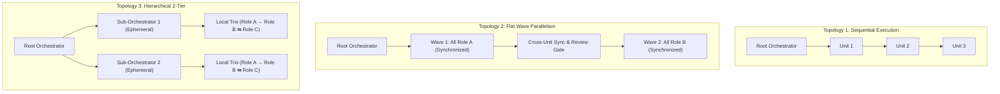

# Authoring Guide: Multi-Agent Parallelization Strategies

This guide defines the architectural patterns and authoring rules for designing **parallelized multi-agent workflows** in WeaveMAS.

---

## 🎯 1. Architectural Philosophy: Semantics Over Arbitrary Numbers

In WeaveMAS, the choice of parallelization strategy is **never driven by arbitrary subagent counts**. Instead, it is strictly determined by the **workflow semantics, cross-unit dependencies, and review lifecycle requirements** of the tasks being executed.

### Mandatory Orchestrator Declaration
Whenever a stage or pipeline executes tasks in parallel, the author **MUST** explicitly state and detail the chosen parallelization strategy in the **`## Execution Protocol`** (or `## Execution`) section of the orchestrator guide (`orchestrator.md` or modular `orchestrator/<stage>.md`).

---

## 🏛️ 2. The Three Orchestration Topologies



### Topology 1: Sequential Execution (Linear Flow)
* **Semantics**: Each unit strictly depends on the finalized output of the previous unit, or the creative process requires building a single continuous narrative thread incrementally.
* **Flow**: The orchestrator spawns one agent at a time, verifies its deliverable, and stages it for the next agent.
* **When It Makes Sense**:
  * Step $B$ cannot be conceptualized or scoped without Step $A$'s finalized result.
  * Work units have sequential narrative continuity (e.g., Act 1 sets the premise $\rightarrow$ Act 2 escalates $\rightarrow$ Act 3 resolves).

---

### Topology 2: Flat Wave Parallelism (Synchronized Phased Waves)
* **Semantics**: Work units are executed in synchronized batches by role, where the root orchestrator enforces a **global synchronization or cross-unit review gate** between phases.
* **Flow**:
  1. **Wave 1**: Root batch-invokes all Role A agents (e.g. all segment architects) concurrently.
  2. **Wave Boundary & Global Review**: Root waits until all Role A deliverables are verified. The orchestrator inspects the combined set of outputs to perform global cross-unit checks (e.g., deduplicating themes, rebalancing segment durations, ensuring tonal contrast across parts).
  3. **Wave 2**: Root batch-invokes all Role B agents (e.g. all writers) concurrently, providing both their specific outline and the shared global context.
* **When It Makes Sense**:
  * **Global Coherence Dominates**: The pipeline requires a holistic checkpoint across all units before permitting downstream work (e.g., ensuring no two talk segments cite the same news source or play the same artist).
  * **One-Shot Transformations**: Downstream workers execute directly without iterative critique or revision cycles (no local back-and-forth loops).
  * **Zero Manager Overhead**: All tokens go directly to worker outputs; no intermediary coordinator agents are needed.

---

### Topology 3: Hierarchical 2-Tier Orchestration (Delegated Ephemeral Sub-Orchestrators)
* **Semantics**: Each unit represents an **autonomous creative sub-pipeline** requiring localized review, auditing, or revision cycles (e.g., Writer ⇆ Fact-Checker revision loops, or Drafter ⇆ Quality-Auditor critique).
* **Flow**:
  1. The Root Orchestrator batch-dispatches $N$ **Ephemeral Sub-Orchestrators** (e.g., Segment Producers), one for each parallel unit.
  2. Each Sub-Orchestrator autonomously manages the sequential handoff and iterative review loops among its assigned worker agents.
  3. Once verified, each Sub-Orchestrator returns its finalized unit deliverable back to the Root Orchestrator.
* **When It Makes Sense**:
  * **Localized Revision Loops**: Workers require iterative feedback (e.g., a Fact-Checker flags errors and asks the Writer to revise). Routing these localized revision cycles through the root orchestrator would create an operational bottleneck and flood the root context window with intermediate drafts.
  * **Asynchronous Completion**: Units have variable processing times. Segment 1 can finish outlining, writing, and auditing in 45 seconds without being blocked waiting for Segment 4 to finish outlining.
  * **Root Context Window Protection**: The root orchestrator's conversation thread remains clean and high-level, observing only the final deliverable handoffs.

---

## ⚖️ 3. Selection Decision Matrix

Base your choice on the architectural nature of the task:

| Evaluation Dimension | Topology 1: Sequential | Topology 2: Flat Wave Parallelism | Topology 3: Hierarchical 2-Tier |
| :--- | :--- | :--- | :--- |
| **Unit Dependency** | Strictly linear; unit $i+1$ requires unit $i$. | Orthogonal units, but requires cross-unit sync between roles. | Completely autonomous units; zero cross-unit dependency during generation. |
| **Review & Iteration** | Sequential in root context. | One-shot per wave; no local feedback loops between roles. | **Autonomous localized review loops** (Writer ⇆ Fact-Checker) encapsulated within unit. |
| **Global Synchronization** | Continuous. | **Strong at wave boundaries** (ideal for deduplication & balancing). | None during generation; aggregated only at stage completion. |
| **Root Context Budget** | Minimal context footprint. | Context window receives all worker signals across waves. | **Completely protected**; intermediate drafts & critiques stay in sub-orchestrator thread. |
| **Active Subagents** | 1 subagent at a time. | Concurrency = count of workers in the active wave. | Concurrency = $N$ sub-orchestrators + active child workers. |
| **Manager Token Cost** | Zero extra tokens. | Zero extra tokens (no middle managers). | Consumes tokens for $N$ ephemeral coordinator prompts. |

---

## 📜 4. The Ephemeral Sub-Orchestrator Protocol

When authoring a Hierarchical 2-Tier pipeline, the sub-orchestrator follows the **Ephemeral Coordinator Pattern**:

### 1. Zero Directory Nesting (Standard Flat Paths)
* **All worker agents live in their standard stage directories** (e.g. `stage03_writing/agents/architect_a01_s01/`, `writer_a01_s01/`, `factchecker_a01_s01/`).
* **DO NOT invent artificial nested `<unit_id>/` subfolders on disk**.
* The Sub-Orchestrator is simply parameterized via its prompt with the specific list of agent identifier slugs it is responsible for supervising.

### 2. Zero `status.md` Creation (Master State Integrity & Clean UI)
* Sub-orchestrators operate directly in the shared context root (`output/<context_slug>/`).
* **Sub-orchestrators MUST NEVER create a `status.md` for themselves and MUST NEVER edit the root `status.md`**.
* *Why*: The root `status.md` belongs exclusively to the Root Orchestrator. Because the Sub-Orchestrator writes no `status.md`, the WeaveMAS sidecar UI dashboard remains 100% focused on actual content producers, with zero redundant "ghost manager" cards.

### 3. Encapsulated Local Revision Cycles
* The Sub-Orchestrator coordinates handoffs between its assigned worker agents.
* If a downstream agent (e.g. Fact-Checker) flags issues in an upstream agent's deliverable (e.g. Writer's draft), the Sub-Orchestrator sends the critique directly to the existing agent instance via `send_message(Recipient: <agent_conversation_id>)`.
* Local revision loops iterate in-place up to an explicit hard cap (maximum 2 cycles). Intermediate drafts and feedback are never escalated to the Root Orchestrator.

### 4. Deliverable Handoff Back to Root
* Upon verifying the finalized unit deliverable via `call_mcp_tool` (`status_read`), the Sub-Orchestrator copies or saves the unit deliverable (e.g. `stage03_writing/segments/segment_01.md`) and completes its turn.

---

## ✍️ 5. Declarative Execution Protocol Templates

### Pattern A: Flat Wave Parallelism in `## Execution Protocol`

```markdown
## Execution Protocol: Flat Wave Parallelism

This stage executes in synchronized waves with a cross-unit review checkpoint between planning and drafting.

### Wave 1: Segment Architecture (Parallel)
1. **Pre-Spawn Scaffolding**:
   For each segment (`seg_01` to `seg_05`), scaffold `agents/architect_<seg_id>/` and initialize status (`status.md`) with `role: "architect_<seg_id>"`. Stage `01_setup.md` into each workspace.
2. **Batch Dispatch**:
   Dispatch all 5 `architect_<seg_id>` agents concurrently via `invoke_subagent`.
3. **Synchronization & Ingestion**:
   Wait for all 5 architects to complete. Read status via `status_read` and verify each `beats.md`.

### Wave Boundary Review Gate (Cross-Unit Checkpoint)
The orchestrator reads all 5 `beats.md` files simultaneously:
* Verify narrative pacing contrast across segments.
* Ensure zero duplicate topic coverage or song selections.
* Adjust target word count parameters for Wave 2 if needed.

### Wave 2: Segment Drafting (Parallel)
1. **Pre-Spawn Scaffolding**:
   For each segment, scaffold `agents/writer_<seg_id>/` and stage its verified `beats.md`.
2. **Batch Dispatch**:
   Dispatch all 5 `writer_<seg_id>` agents concurrently.
3. **Ingestion & Aggregation**:
   Wait for all writers to complete. Ingest verified `draft.md` files into `02_segments.md`.
```

---

### Pattern B: Hierarchical Sub-Orchestration in `## Execution Protocol`

```markdown
## Execution Protocol: Hierarchical 2-Tier Sub-Orchestration

Each segment represents an autonomous drafting and factual audit pipeline. The root orchestrator delegates each segment to an ephemeral Segment Producer sub-orchestrator to encapsulate local review loops.

### 1. Upfront Worker Scaffolding
For each segment (`seg_01` to `seg_10`):
* Scaffold standard agent directories under `stage03_writing/agents/`:
  - `architect_<seg_id>/` (initialize status with `role: "architect_<seg_id>"`, stage `01_setup.md`)
  - `writer_<seg_id>/` (initialize status with `role: "writer_<seg_id>"`)
  - `factchecker_<seg_id>/` (initialize status with `role: "factchecker_<seg_id>"`)

### 2. Delegated Sub-Orchestrator Dispatch
Batch-dispatch 10 ephemeral Segment Producer sub-orchestrators (`TypeName: "self"`):
* **Assigned Scope**: Pass the exact segment ID and assigned agent slugs (`architect_<seg_id>`, `writer_<seg_id>`, `factchecker_<seg_id>`).
* **Sub-Orchestrator Execution Contract**:
  1. Spawns `architect_<seg_id>` $\rightarrow$ verifies `beats.md` $\rightarrow$ stages into `writer_<seg_id>/`.
  2. Spawns `writer_<seg_id>` $\rightarrow$ verifies `draft.md` $\rightarrow$ stages into `factchecker_<seg_id>/`.
  3. Spawns `factchecker_<seg_id>` $\rightarrow$ ingests `audit_report.md`.
  4. **Encapsulated Revision Loop**: If `audit_report.md` contains flagged claims, the Segment Producer messages `writer_<seg_id>` via `send_message` with correction directives (max 2 revision cycles).
  5. The Segment Producer creates NO `status.md` for itself.
  6. Upon completion, copies finalized prose to `stage03_writing/segments/<seg_id>.md`.

### 3. Stage Aggregation
The root orchestrator receives completion notifications from all 10 Segment Producers, verifies final segment files on disk, and compiles them into stage deliverable `03_script.md`.
```
