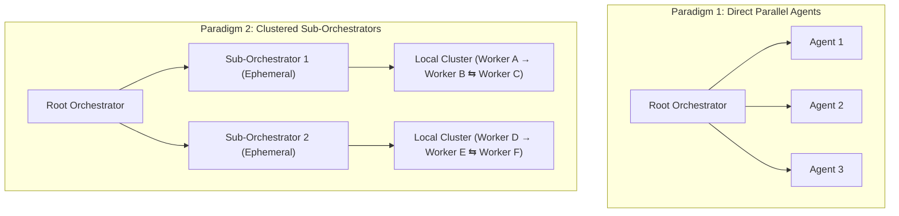

# Authoring Guide: Multi-Agent Parallelization Strategies

This guide defines the architectural patterns and declarative authoring rules for designing **parallelized multi-agent workflows** in WeaveMAS.

---

## 🎯 1. Architectural Philosophy: Semantics Over Arbitrary Numbers

In WeaveMAS, the choice of parallelization strategy is **never driven by arbitrary subagent counts**. Instead, it is strictly determined by:
1. **Dependency Structure**: Are work items sequentially dependent, or can they run concurrently?
2. **Review & Revision Cycles**: Do workers execute one-shot tasks, or do they participate in iterative critique and revision loops (e.g. Writer ⇆ Fact-Checker)?
3. **Cross-Unit Synchronization**: Does the workflow require a holistic global checkpoint across all units before permitting downstream work?

---

## 🏛️ 2. The Two Parallelization Paradigms



### Paradigm 1: Direct Parallel Agents
The Root Orchestrator directly dispatches and supervises individual worker agents concurrently in a single turn.

* **When to Use**:
  * **One-Shot Transformations**: Agents perform straightforward execution without iterative critique loops or back-and-forth review ping-pong.
  * **Global Cross-Unit Gates (Waves)**: Running all workers of Role A concurrently (e.g., all architects), pausing at a synchronization barrier so the root orchestrator can inspect all outputs for deduplication and narrative balance, then running all workers of Role B concurrently.
  * **Zero Manager Overhead**: All tokens are spent directly on generation; no intermediary coordinator agents are needed.

* **Two Authoring Forms**:
  1. **Parameterized Loop (Homogeneous Roles)**:
     ```markdown
     For each segment (`seg_01` to `seg_05`), run `architect_<seg_id>` in parallel:
     - Inputs: Staged `02_concept.md`, segment parameters.
     - Deliverable: Ingest verified `beats.md`.
     ```
  2. **Explicit List (Heterogeneous Roles Running Concurrently)**:
     ```markdown
     Run the following agents in parallel:
     * `showrunner_editorial`: Refines narrative tone and pacing constraints.
     * `youtube_sourcer`: Researches historical background and clips.
     * `playlist_curator`: Selects matching musical transitions.
     ```

---

### Paradigm 2: Clustered Sub-Orchestrators
The Root Orchestrator groups a multi-agent sub-pipeline into a **Sub-Orchestrator**, and runs those sub-orchestrators in parallel.

* **When to Use**:
  * **Localized Revision Loops**: Workers require iterative feedback (e.g., a Fact-Checker audits a Writer's draft and requests revisions). Routing localized revision cycles through the root orchestrator would create an operational bottleneck and flood the root context window.
  * **Asynchronous Unit Lifecycles**: Units take varying amounts of time to complete. Unit 1 can finish outlining, writing, and auditing without waiting for Unit 4 to finish outlining.
  * **Root Context Protection**: The root orchestrator's conversation thread remains clean and high-level, observing only final deliverable handoffs.

* **Two Authoring Forms**:
  1. **Parameterized Loop (Homogeneous Units)**:
     Use when multiple units execute the same multi-agent workflow (e.g. 10 radio talk segments):
     ```markdown
     For each `TALK` segment (`a<AA>_s<SS>`), cluster into a sub-orchestrator and execute in parallel:
     
     1. **`architect_a<AA>_s<SS>`**:
        - Inputs: Staged `02_concept.md`, segment ID.
        - Handoff: Ingest verified `beats.md` and stage into `writer_a<AA>_s<SS>` workspace.

     2. **`writer_a<AA>_s<SS>`**:
        - Inputs: Staged `beats.md`, staged `persona.md`.
        - Handoff: Ingest verified `draft.md` and stage into `factchecker_a<AA>_s<SS>` workspace.

     3. **`factchecker_a<AA>_s<SS>`**:
        - Inputs: Staged `draft.md`.
        - Ingestion & Revision Gate: Ingest verified `audit_report.md`. If revisions needed, message `writer_a<AA>_s<SS>` via `send_message` (max 2 cycles).
     ```

  2. **Explicit Heterogeneous Clusters (Different Agents & Content)**:
     Use when parallel tracks have completely different subagent teams and tasks:
     ```markdown
     Cluster each of the following tracks into a sub-orchestrator and execute in parallel:

     * **Story Production Track**:
       1. `story_architect`: Drafts segment narrative beats.
       2. `script_writer`: Writes spoken dialogue from beats.
       3. `fact_checker`: Audits claims and messages `script_writer` for corrections if needed.

     * **Music & Audio Track**:
       1. `music_selector`: Curates song transitions based on tempo and genre tags.
       2. `audio_balancer`: Verifies audio levels and fade durations.

     * **Sponsor & Promo Track**:
       1. `promo_copywriter`: Drafts mid-roll sponsor announcement.
       2. `compliance_auditor`: Audits legal disclaimers and messages `promo_copywriter` for tweaks.
     ```

---

## ⚖️ 3. Selection Decision Matrix

| Evaluation Dimension | Direct Parallel Agents | Clustered Sub-Orchestrators |
| :--- | :--- | :--- |
| **Worker Interaction** | Independent one-shot tasks; no back-and-forth loops. | **Iterative feedback loops** (e.g., Writer ⇆ Fact-Checker) between workers. |
| **Cross-Unit Synchronization** | **Strong**: Phased waves pause at boundaries for global checks & deduplication. | **Decoupled**: Each unit completes on its own timeline. |
| **Root Context Load** | Absorbs all worker signals and tool completions. | **Minimal**: Intermediate draft iterations stay private in sub-orchestrator threads. |
| **Active Subagents** | Number of workers in the current wave. | $N$ sub-orchestrators + their currently active child workers. |
| **Manager Token Cost** | Zero extra tokens (no middle managers). | Consumes tokens for $N$ ephemeral coordinator prompts. |

---

## 📜 4. The Ephemeral Sub-Orchestrator Protocol

When authoring or executing clustered sub-orchestrators, the sub-orchestrator follows the **Ephemeral Coordinator Pattern**:

1. **Zero Directory Nesting (Standard Flat Paths)**:
   * Worker agents reside in their standard stage directories (e.g. `stage03_writing/agents/architect_a01_s01/`).
   * **DO NOT invent artificial nested `<unit_id>/` subfolders on disk**.
   * The Sub-Orchestrator is parameterized via its prompt with the specific list of agent identifiers it supervises.

2. **Zero `status.md` Creation (Master State Integrity & Clean UI)**:
   * Sub-orchestrators operate directly in the shared context root (`output/<context_slug>/`).
   * **Sub-orchestrators MUST NEVER create a `status.md` for themselves and MUST NEVER edit the root `status.md`**.
   * *Why*: The root `status.md` belongs exclusively to the Root Orchestrator. Because the Sub-Orchestrator writes no `status.md`, the WeaveMAS sidecar UI dashboard remains 100% focused on actual content producers, with zero redundant "ghost manager" cards.

3. **Encapsulated Local Revision Cycles**:
   * The Sub-Orchestrator coordinates handoffs between its assigned worker agents.
   * If a downstream agent (e.g. Fact-Checker) flags issues, the Sub-Orchestrator routes the critique directly to the existing agent instance via `send_message(Recipient: <agent_conversation_id>)`.
   * Revisions iterate in-place up to a hard cap (maximum 2 cycles) without escalating intermediate drafts to the Root Orchestrator.

4. **Deliverable Handoff Back to Root**:
   * Upon verifying the child deliverables via `status_read`, the Sub-Orchestrator copies or writes the verified unit deliverable and finishes its turn.
