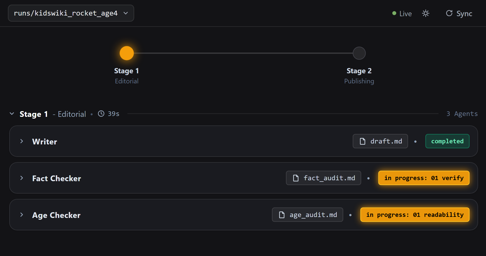
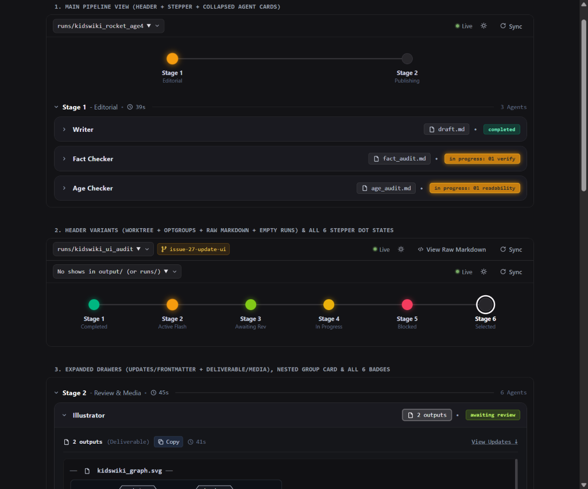
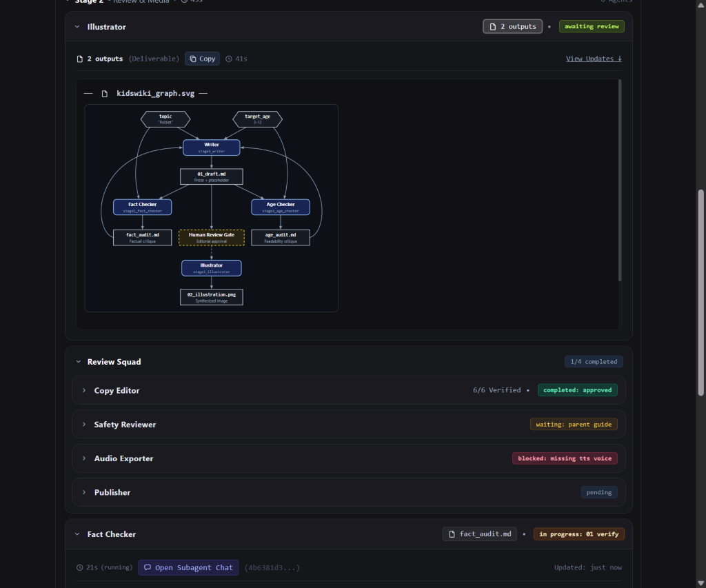
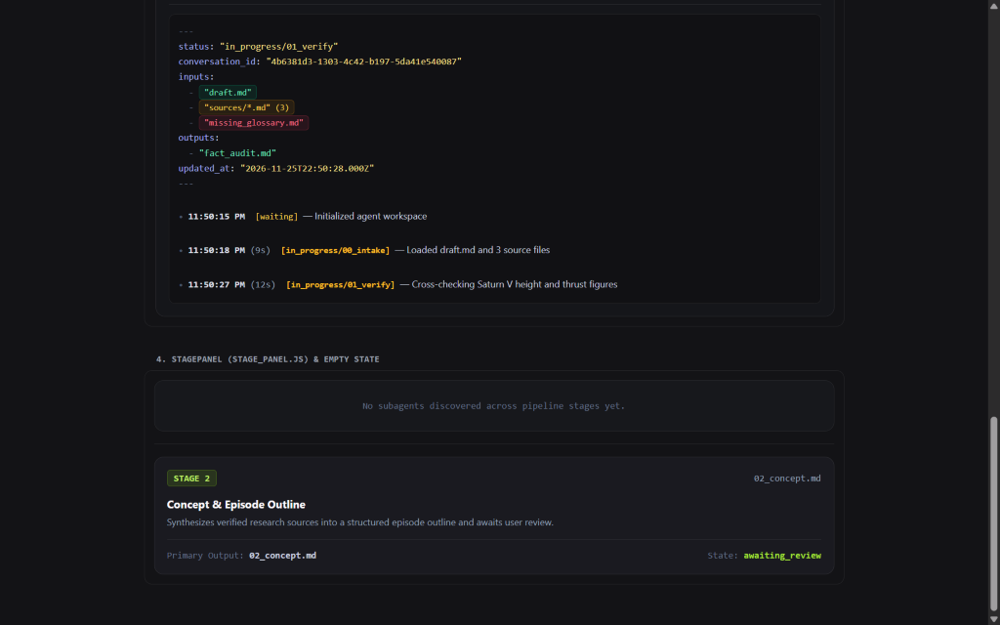

# WeaveMX Sidecar UI Inventory (`sidecars/panel/`)

> **Scope:** Complete audit of every screen, header control, stepper state, stage section, group/agent card, expandable drawer, deliverable/media preview, badge, tooltip, and empty/loading/error state in `sidecars/panel/`.
> **Ground Truth Source:** Every visual below is an **actual screenshot** — either the pre-Issue-27 repo capture ([docs/ui-mocks/inventory-baseline-kidswiki.png](docs/ui-mocks/inventory-baseline-kidswiki.png)) or a live browser render of [docs/ui-mocks/inventory.html](docs/ui-mocks/inventory.html), which executes the **unmodified pre-Issue-27 `sidecars/panel/` JS modules** (`header_bar.js`, `runtime_tracker.js`, `agent_panel.js`, `stage_panel.js`, `app.js` stepper) with the pre-Issue-27 `styles.css`.

---

## Visual Baseline (Actual Code Renders)

### 1. Main Pipeline View (Pre-Update Baseline)

### 2. Header Variants (Worktree Badge, Raw Markdown Button, Empty Runs) & All 6 Stepper Dot States
*(Actual browser render of unmodified `header_bar.js` + `app.js` + `styles.css` in [docs/ui-mocks/inventory.html](docs/ui-mocks/inventory.html))*

### 3. Expanded Deliverable/Media Drawer, Nested Group Card & All 6 Status Badges
*(Actual browser render of unmodified `agent_panel.js` + `styles.css`)*

### 4. Expanded Updates/Frontmatter Drawer, Empty State & `StagePanel` (`stage_panel.js`)
*(Actual browser render of unmodified `agent_panel.js` + `runtime_tracker.js` + `stage_panel.js` + `styles.css`)*

---

## Summary of Minor Styling Issues to Address (Zero Functional Redesign)

1. **Hardcoded theme colors override Antigravity host CSS variables:** `styles.css` (`L66-L162`) hardcodes `--agy-bg: #131316` / `#f8fafc` inside `[data-theme="dark"]` and `[data-theme="light"]` and relies on ~120 lines of `[data-theme="light"] .text-slate-* !important` overrides instead of binding directly to `agy` host CSS variables (`--background`, `--foreground`, `--card`, `--card-border`, `--border`, `--primary`, etc.) and listening for `theme-change` messages.
2. **Loud neon glow & full-badge blinking on active states:** `.stage-dot-*` uses `0 0 10px`–`14px` neon `box-shadow` blurs, and `.vivid-pulse` (`in progress: ...`) flashes solid `#f59e0b` with black bold text (visible in `assets/weavemx_ui_kidswiki.png`), clashing with the restrained translucent `completed` / `awaiting review` / `waiting` / `blocked` badges.
3. **3 residual raw Unicode glyphs in `agent_panel.js`:** While 11 crisp SVG icons already exist across `header_bar.js`, `agent_panel.js`, and `runtime_tracker.js`, `agent_panel.js` still outputs raw Unicode characters in multi-output dividers (`L176`), copy feedback (`L327`), and `View Updates &darr;` (`L203`).

---

## Component-by-Component Inventory

### 1. Shell & Sticky Header Bar (`index.html`, `trackers/header_bar.js`, `styles.css`)

| # | Component / Control | File Path | Trigger | Static / Dynamic | Screenshot Reference |
|---|---|---|---|---|---|
| 1.1 | **Root Document & Theme Bootstrap** (`html[data-theme]`, `body`) | `index.html` (`L1-L24`), `styles.css` (`L1-L174`) | Page load; reads `localStorage['weavemx-ui-theme']` (defaults to `'dark'`); loads `/preload.js` | Dynamic `data-theme` | `weavemx_ui_kidswiki.png` |
| 1.2 | **Sticky Header Container** (`.agy-header`) | `trackers/header_bar.js` (`L469`), `styles.css` (`L144-L176`) | Mounted on `bootApp()` and updated on `renderUI()`; single-line `flex-wrap: nowrap` left cluster | Dynamic child state | `weavemx_ui_kidswiki.png` |
| 1.3 | **Pipeline Run Selector** (`#show-select`, `.agy-select`) | `trackers/header_bar.js` (`L471-L478`, `L543-L576`) | Populated from `availableContexts` / `availableShows`; shrinks smoothly down to `84px` min-width in narrow panes | Dynamic `<option>` / `<optgroup>` | `weavemx_ui_kidswiki.png`, `inventory-header-stepper.png` |
| 1.4 | **Git Worktree Badge** (`#worktree-badge`, `.agy-worktree-badge`) | `trackers/header_bar.js` (`L350-L357`, `L578-L582`) | Active run has `isWorktree`/`worktree`; single-line `.agy-worktree-name.truncate` (`max-width: 200px`, `112px` at `<= 480px`) with full branch in `title="Executing in Git Worktree: <name>"` | Dynamic | `inventory-header-stepper.png` |
| 1.5 | **Live Auto-Sync Indicator** (`.agy-live`, `.pulsing-dot`) | `trackers/header_bar.js` (`L482-L485`), `styles.css` (`L263-L270`) | Always rendered (`role="status"`, `title="Live Auto-Sync Active"`); `.agy-live-label` hides below `380px` | Static label + animated dot | `weavemx_ui_kidswiki.png` |
| 1.6 | **Theme Toggle Button** (`#theme-toggle-btn`, `.agy-theme-btn`) | `trackers/header_bar.js` (`L300-L330`, `L486-L488`) | Click toggles `dark` / `light`, updates `data-theme`, `aria-pressed`, `title`, SVG sun/moon icon | Dynamic SVG + ARIA | `weavemx_ui_kidswiki.png` |
| 1.7 | **View Raw Markdown Button** (`#raw-markdown-btn`, `.agy-raw-btn`) | `trackers/header_bar.js` (`L462-L464`), `app.js` (`L124-L126`) | Rendered when `WeaveHostBridge.viewRawMarkdown` is provided (VS Code host); collapses to icon-only (`26x26px`) with `title` / `aria-label` at `<= 480px` | Static (conditional) | `inventory-header-stepper.png` |
| 1.8 | **Manual Sync Button** (`#sync-btn`, `.agy-sync-btn`) | `trackers/header_bar.js` (`L490-L495`) | Click triggers `onSync` (`refreshData()`); collapses to icon-only (`26x26px`) with `title` / `aria-label` at `<= 480px` | Static | `weavemx_ui_kidswiki.png` |

### 2. Horizontal Pipeline Stepper (`app.js`, `styles.css`)

| # | Component / State | File Path | Trigger | Static / Dynamic | Screenshot Reference |
|---|---|---|---|---|---|
| 2.1 | **Scrollable Stepper Track & Connecting Line** (`#stepper-root.weave-stepper-scroll`, `#stepper-track.weave-stepper-track`, `#stepper-line`) | `index.html` (`L71-L81`), `extension.js` (`L383-L388`), `app.js` (`L142-L175`) | Visible when `stageList.length > 0`; `overflow-x: auto` container with `#stepper-track` sized to `max(100%, N * 72px)` so `#stepper-line` spans all stage centers | Dynamic | `weavemx_ui_kidswiki.png` |
| 2.2 | **Stepper Item & Stage Filter** (`.weave-stepper-item`) | `app.js` (`L208-L214`, `L229-L239`), `styles.css` (`L395-L418`) | One per stage (`flex: 1 0 72px; min-width: 72px`); single-line `whitespace-nowrap` `Stage N` title + `max-w-[70px]` truncated subtitle; click calls `App.selectStage(num)` | Dynamic | `inventory-header-stepper.png` |
| 2.3 | **6 Dot States + Selected Ring** (`.stage-dot-*`) | `app.js` (`L199-L205`), `styles.css` (`L432-L480`) | `completed` (emerald), `flashing` (active leaf agent), `awaiting_review` (lime), `in_progress` (yellow), `blocked` (rose), `pending` (zinc), `selected` (`1.18x` scale + outline) | Dynamic | `inventory-header-stepper.png` |

### 3. Multi-Stage Agents Panel & Expandable Drawers (`trackers/agent_panel.js`, `trackers/runtime_tracker.js`, `trackers/stage_panel.js`)

| # | Component / Surface | File Path | Trigger | Static / Dynamic | Screenshot Reference |
|---|---|---|---|---|---|
| 3.1 | **Stage Section Header & Runtime** (`.weave-stage-row`) | `agent_panel.js` (`L269-L273`), `runtime_tracker.js` (`L145-L254`) | One per non-empty stage; click toggles `collapsedStages`; single-line `Stage N`, truncated stage name (`min-w-0`), and `whitespace-nowrap` 200ms live runtime ticker | Dynamic | `weavemx_ui_kidswiki.png` |
| 3.2 | **Nested Agent Group Card** (`.weave-group`, `getGroupSummaryChip`) | `agent_panel.js` (`L131-L137`, `L230-L238`) | `node.type === 'group'`; click toggles `expandedGroups`; truncated group title + `whitespace-nowrap` `X/Y completed` badge | Dynamic | `inventory-drawers-groups.png` |
| 3.3 | **Agent Card Header, Value Chip & 6 Status Badges** | `agent_panel.js` (`L21-L52`, `L187-L221`) | Container query `weave-card` (`inline-size`); single-line `whitespace-nowrap` `.weave-deliverable-chip` and `.weave-badge` (`inline-block truncate`, `title` tooltip) keep rows uniform height at narrow widths | Dynamic | `weavemx_ui_kidswiki.png`, `inventory-drawers-groups.png` |
| 3.4 | **Updates Drawer (Toolbar, Frontmatter Pills & Logs)** | `agent_panel.js` (`L53-L107`, `L198`, `L208`), `runtime_tracker.js` (`L94-L100`, `L277-L331`) | Card expanded in `updates` mode; `whitespace-nowrap` runtime timer; at `<= 460px` card width (`<= 480px` viewport), `Open Subagent Chat` collapses to icon-only (`title="Open Subagent Chat"`, `aria-label`) and hides `(uuid...)` | Dynamic | `inventory-drawers-groups.png`, `inventory-frontmatter-stagepanel.png` |
| 3.5 | **Deliverable & Media Preview Drawer** | `agent_panel.js` (`L139-L185`, `L203-L206`), `main.mjs` (`L150-L199`) | Card expanded in `deliverable` mode; truncated filename (`min-w-0`); at narrow widths, hides `(Deliverable)` and collapses `Copy` and `View Updates` to icon-only buttons with `title` / `aria-label` | Dynamic | `inventory-drawers-groups.png` |
| 3.6 | **Stage Summary Card (`StagePanel`)** | `stage_panel.js` (`L13-L59`) | Secondary module exported on `window.StagePanel` / `window.GenericTracker` | Dynamic | `inventory-frontmatter-stagepanel.png` |

### 4. Tooltips, Empty, Loading & Error States

| # | State | File Path | Trigger | Current Behavior | Screenshot / Note |
|---|---|---|---|---|---|
| 4.1 | **Native `title` Tooltips** | `header_bar.js`, `app.js`, `runtime_tracker.js`, `agent_panel.js` | Hover on header controls, worktree badge, stepper dots, runtime badges, `Updated:` timestamp | Native browser `title` attribute | Preserved as-is |
| 4.2 | **Initial Loading & Empty Runs (`<select>`)** | `header_bar.js` (`L377`, `L452`) | Boot (`"Detecting runs..."`) or `availableItems.length === 0` (`"No shows in output/ (or runs/)"`) | `<option>` inside `#show-select` | `inventory-header-stepper.png` |
| 4.3 | **Empty Agents State (`.weave-empty-state`)** | `agent_panel.js` (`L249-L250`) | `stageList.length === 0 || totalAgents === 0` | `"No subagents discovered across pipeline stages yet."` | `inventory-frontmatter-stagepanel.png` |
| 4.4 | **Empty Logs / Unwritten Deliverable** | `agent_panel.js` (`L168`, `L211`, `L214`) | Agent has no logs yet or deliverable file not yet written | Muted text inside expanded card | Styled via host muted token |
| 4.5 | **API Fetch Error (`app.js` `L79-L81`)** | `app.js` (`L79-L81`) | `/api/pipeline` fails | Currently logs to console only | Add lightweight non-intrusive error state / retry if desired, without altering normal flow |
