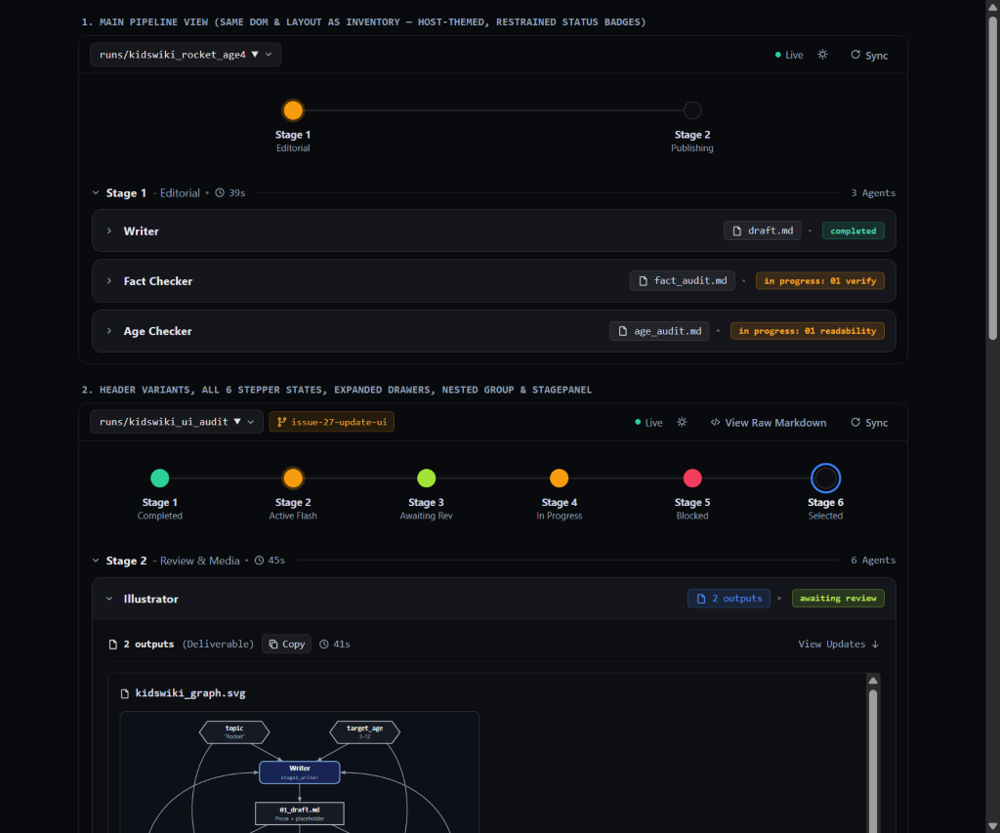
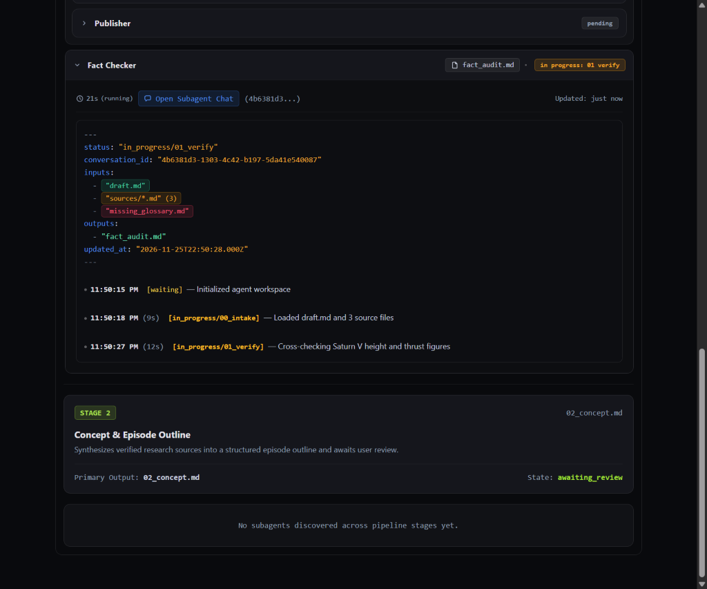
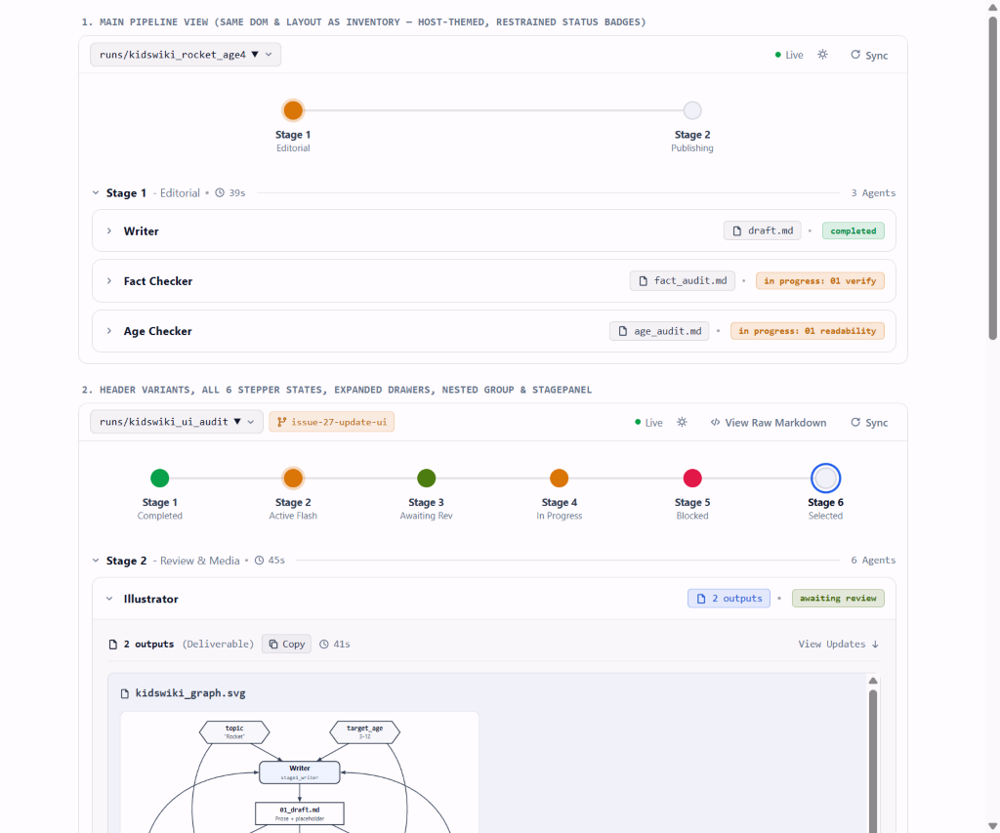
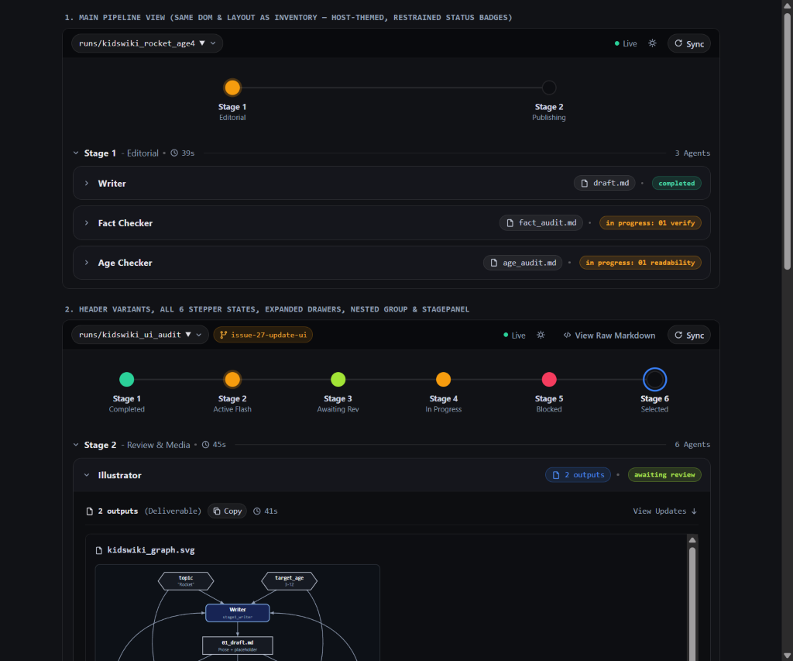
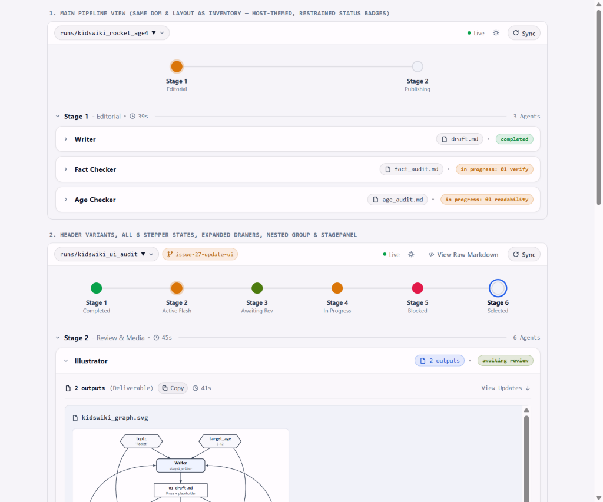

# WeaveMX Sidecar UI Mockups (`ui-mockups.md`)

> **Scope — Minor Styling & Host Theme Inheritance Only (Zero Functional Changes):**
> All mockups below are **actual browser screenshots** of [docs/ui-mocks/mockups.html](docs/ui-mocks/mockups.html), built from the **exact DOM output of `sidecars/panel/*.js`**. Layout, controls, interactions, and information hierarchy remain identical to [ui-inventory.md](ui-inventory.md) — changing **only** CSS host variable bindings, removing neon dot glows / solid-orange `.vivid-pulse` flashing, harmonizing light/dark contrast, and replacing the 3 residual Unicode symbols with `12x12` SVG icons per [DESIGN.md](DESIGN.md).
> **Interactive HTML Preview:** Open [docs/ui-mocks/mockups.html](docs/ui-mocks/mockups.html) to switch live between **Option A**, **Option B**, and 4 Antigravity host presets (**Onyx Dark**, **Onyx Light**, **Catppuccin Mocha**, **Solarized Light**).

---

## Option A: Flat Native Fit *(Closest to current UI — Recommended)*

Preserves the exact geometry of the current WeaveMX UI (`10px` card radius, `6px` header control radius, `4px` chip/badge radius, flat `--background` canvas):
- Binds surfaces, borders, text, and accents directly to `agy` host CSS variables (`--background`, `--card`, `--card-border`, `--border`, `--foreground`, `--muted-foreground`, `--secondary`, `--primary`).
- Replaces `.vivid-pulse`'s blinding solid-orange blink with a restrained amber translucent badge matching `completed` / `awaiting review` / `waiting` / `blocked`, and replaces `.stage-dot-*` `10px–14px` neon `box-shadow`s with clean flat fills + a calm `3px` ring on active stages.

### Option A — Onyx Dark (Main View + Header Variants, 6 Stepper States & Deliverable Drawer)

### Option A — Onyx Dark (Nested Group, All Badges, Frontmatter/Log Drawer, `StagePanel` & Empty State)

### Option A — Onyx Light

---

## Option B: Soft Onyx Pill Contrast *(Subtle Antigravity 2.29 Pill Radii)*

Identical DOM, layout, and functionality as Option A — differing **only** in minor surface and border-radius tokens inspired by `antigravity-sidecar-kit` (`controls.css` / `surfaces.css`):
- Maps page canvas to `--shell` so `--card` (`12px` radius) rows stand slightly apart from the background (`0 1px 2px` subtle shadow in light mode).
- Uses `9999px` pill border-radius on `#show-select`, `#sync-btn`, `#worktree-badge`, `.weave-deliverable-chip`, and `.weave-badge`.

### Option B — Onyx Dark

### Option B — Onyx Light

---

## Option Comparison Summary

| Token / Property | Current UI (`ui-inventory.md`) | Option A: Flat Native Fit | Option B: Soft Onyx Pill Contrast |
|---|---|---|---|
| **Layout & Functionality** | Baseline | **Unchanged (100% identical)** | **Unchanged (100% identical)** |
| **Theme Source** | Hardcoded `#131316` / `#f8fafc` + `!important` slate overrides | Injected `agy` host CSS vars + `theme-change` listener | Injected `agy` host CSS vars + `theme-change` listener |
| **Canvas vs. Card Surface** | `#131316` / `#1a1b20` | `var(--background)` / `var(--card)` | `var(--shell)` / `var(--card)` |
| **Control & Badge Radii** | `6px` controls, `4px` badges, `12px` cards | `6px` controls, `4px` badges, `10px` cards | `9999px` pill controls & badges, `12px` cards |
| **Stepper Dots & Active Badge** | `10px–14px` neon glow + solid orange `.vivid-pulse` blink | Clean `20px` circles + matching translucent amber badge | Clean `20px` circles + matching translucent amber pill badge |
| **Icons** | 11 SVGs + 3 raw Unicode chars | All 13 inline SVGs (zero Unicode icons) | All 13 inline SVGs (zero Unicode icons) |

---

## Approval Request

Please let me know:
1. **Option A (Flat Native Fit)** or **Option B (Soft Onyx Pill Contrast)**?
2. Ready to proceed with applying these styling/theme-binding updates in `sidecars/panel/`?
